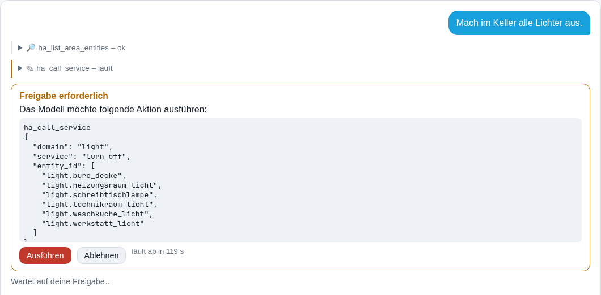
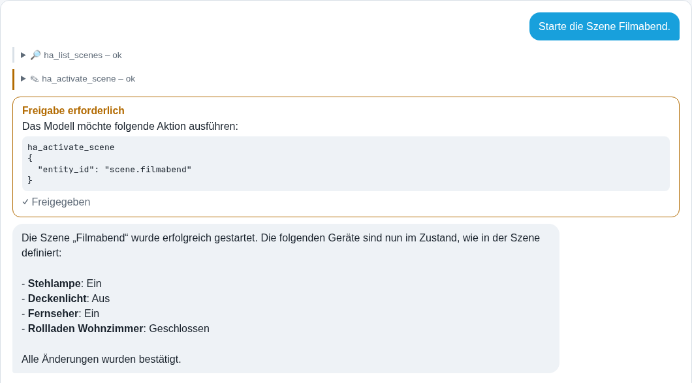
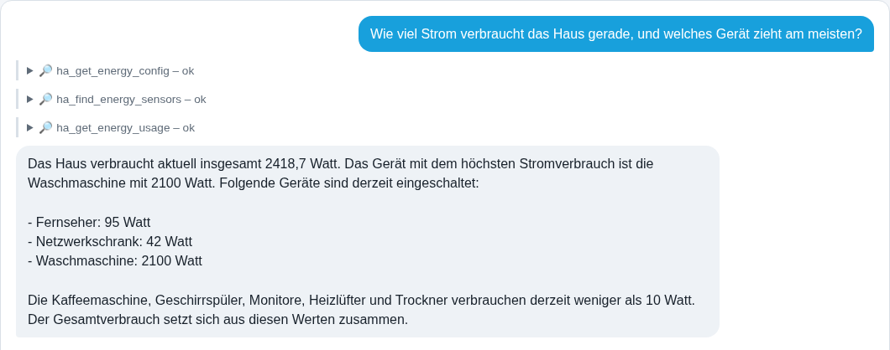
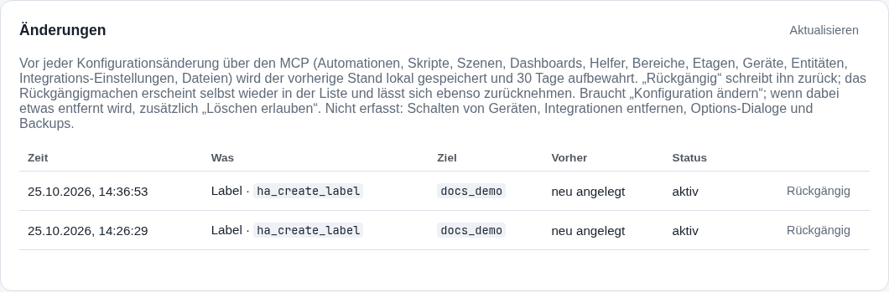
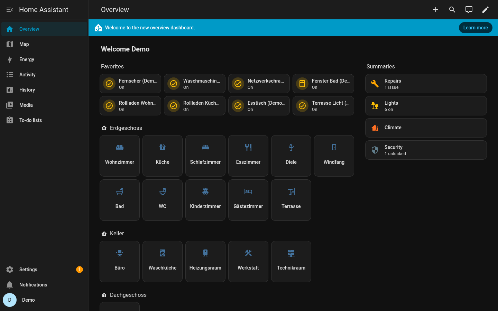
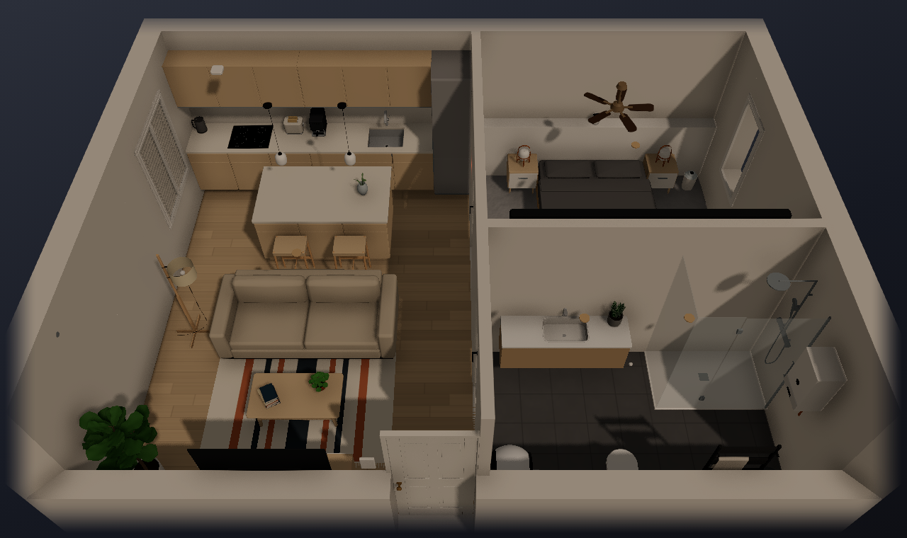
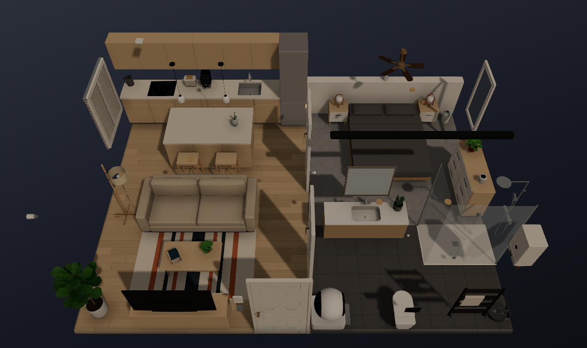

# Home Assistant + lokale KI, sicher

[English](README.md) · **Deutsch**

Zwei Projekte, mit denen ein KI-Modell, auch ein kleines auf eigener Hardware, beim Betrieb eines
Home-Assistant-Zuhauses hilft, ohne dass man ihm die Schlüssel übergibt:

| Projekt | Was es ist | Einstieg |
|---|---|---|
| [**ha-safe-mcp**](ha-safe-mcp/) | Ein selbst gehosteter [MCP](https://modelcontextprotocol.io/)-Server für Home Assistant mit Sicherheit an erster Stelle: 161 Werkzeuge, dazu eine lokale Weboberfläche mit Chat für Ollama-Modelle. Jede Änderung braucht deine Freigabe, wird zurückgelesen und landet in einem Änderungsjournal, aus dem du sie rückgängig machen kannst. | [Funktionsübersicht](ha-safe-mcp/docs/FEATURES.de.md) · [Installation](ha-safe-mcp/docs/INSTALL.de.md) · [Bedienungsanleitung](ha-safe-mcp/docs/USER_GUIDE.de.md) · [Technische Doku](ha-safe-mcp/docs/TECHNICAL.de.md) · [Werkzeug-Referenz (englisch)](ha-safe-mcp/docs/TOOLS.md) |
| [**ha-diorama**](ha-diorama/) | Eine Kopie der MIT-lizenzierten 3D-Karte [CarlesRojas/ha-diorama](https://github.com/CarlesRojas/ha-diorama) mit unseren Ergänzungen: echte Wände (volle oder halbe Höhe, vordere Wände ausgeblendet), Räume aus einem Grundrissbild übernehmen und Prüfwerkzeuge. Dem Original als Beitrag angeboten. | [Unsere Ergänzungen](ha-diorama/hestia/README.md) · [Original](ha-diorama/UPSTREAM.md) · [Doku der Karte](ha-diorama/README.md) |

## So sieht es aus

Alle Bilder stammen aus einem Demo-Zuhause auf einem Wegwerf-Home-Assistant (drei Etagen, 17 Räume, 20 Lampen,
8 geschaltete Geräte mit Leistungsmessung, 7 Rollläden, ein Türschloss, Sensoren). Nichts davon ist ein echter
Haushalt. Das Demo-Zuhause baut [`ha-safe-mcp/scripts/docs_demo_home.py`](ha-safe-mcp/scripts/docs_demo_home.py),
die Chat-Bilder macht [`ha-safe-mcp/scripts/doc_screenshots.py`](ha-safe-mcp/scripts/doc_screenshots.py). Jedes
Bild lässt sich also nachstellen.

**Ein lokales Modell schaltet eine ganze Etage mit einer Freigabe.** *"Mach im Keller alle Lichter aus."* Das
Modell (hier `qwen3-coder:30b` über Ollama) holt die Lampen aller Räume dieser Etage mit einem Aufruf und fragt
einmal. Nichts passiert, bevor du auf *Ausführen* klickst:



**Aktionen werden zurückgelesen, nicht angenommen.** Nach dem Aufruf liest der MCP jedes Ziel erneut, die Antwort
sagt also, was wirklich passiert ist. Bei einer Szene vergleicht er jede Entität mit dem in der Szene gespeicherten
Zustand:



**Sensoren nach ihrer Art finden.** *"Strom"* findet "Fernseher Leistung", *"Fenster"* die Fensterkontakte, auch
wenn die Frage englisch ist:



**Jede Änderung lässt sich rückgängig machen.** Das Änderungsjournal hält den Zustand vor jedem Schreiben fest:



**Das Demo-Zuhause, wie Home Assistant es zeigt:**



**ha-diorama mit unseren Wänden.** Dieselbe Demo-Wohnung mit Wänden (die vorderen Wände sind ausgeblendet, damit
man hineinsieht) und darunter so, wie die Original-Karte sie zeichnet:





Die [Funktionsübersicht](ha-safe-mcp/docs/FEATURES.de.md) geht alle Funktionen mit mehr als 30 solcher Bilder durch.

## Wie wir entwickeln

| Teil | Was er tut |
|---|---|
| **Dev-Home-Assistant** | Ein Home Assistant in Docker mit Demo-Geräten (Lampen, Steckdosen, Rollläden, Sensoren). Jede neue Funktion entsteht zuerst dort, **mit den eigenen Werkzeugen des MCP**, so wie ein kleines Modell sie aufrufen würde. Wo das umständlich ist, bekommt der MCP ein besseres Werkzeug oder eine klarere Fehlermeldung, und die Runde beginnt von vorn. |
| **Ein lokales Modell als Abnahme** | Eine Funktion gilt als fertig, wenn ein lokales Modell im Chat der Weboberfläche sie von Anfang bis Ende schafft, belegt durch die Werkzeug-Ausgabe, nicht durch die Worte des Modells. |
| **Produktion** | Erst was auf Dev bestanden hat, kommt in ein echtes Zuhause, über eine eigene MCP-Instanz mit eigenem Token und eigenen Schaltern. Zugriff von außen läuft über einen Zugangs-Proxy; die Weboberfläche selbst hört nur auf dem eigenen Rechner (Loopback). |
| **Wegwerf-Instanzen** | Doku, Screenshots und Docker-Rauchtests laufen gegen frische Home-Assistant-Container, die danach gelöscht werden. |
| **Tests** | Über 600 Python-Tests für ha-safe-mcp (dazu Rauchtests gegen einen echten Home Assistant Core in Docker), Tests für die Wandgeometrie und den Grundriss-Import der Diorama-Karte und eine Prüfung, dass die generierte Werkzeug-Referenz aktuell ist. |
| **Diorama auf Dev** | `ha-diorama/hestia/deploy_dev.py` legt einen frischen Build der Karte neben die HACS-Kopie einer Testinstanz und wieder zurück. |

## Mit einem KI-Agenten gebaut

Diese Projekte entwickelt Marius Gehrmann zusammen mit **HESTIA**, seinem KI-Agenten für Home Assistant (ein
Hermes-Agent auf Claude Code mit Claude Opus 5.5). HESTIA schreibt den größten Teil von Code, Tests und Doku; Marius
setzt die Ziele, prüft die Änderungen und testet sie in seinem eigenen Zuhause. Jeder Commit ist als KI-Arbeit
gekennzeichnet: Die Zeile `AI-Agent: HESTIA (Claude Code, Claude Opus 5.5)` nennt den Agenten, `Co-Authored-By:
Claude Opus 5.5` das Modell, das ihn geschrieben hat. Einige frühe Commits entstanden, als der Agent kurz auf einem
anderen Modell lief; sie tragen nur die Zeile `AI-Agent: HESTIA`.

## Schnellstart

```bash
git clone https://github.com/GehrmannSolutions/HomeAssistant.git
cd HomeAssistant/ha-safe-mcp
python3 -m venv .venv
.venv/bin/python -m pip install -e .
.venv/bin/ha-mcp-ui        # danach http://127.0.0.1:8765/ auf demselben Rechner öffnen
```

Der Einrichtungsassistent prüft Adresse und Token deines Home Assistant, bevor er etwas speichert. Alle
Schreibrechte sind aus, bis du sie einschaltest. Details, Docker und das Verbinden von MCP-Clients:
[Installationsanleitung](ha-safe-mcp/docs/INSTALL.de.md).

## Sicherheit in Kürze

- **Standardmäßig aus:** Steuern, Konfigurieren und Löschen sind getrennte Schalter, anfangs alle aus.
- **Du gibst jede Änderung frei**, im Chat der Weboberfläche über eine Freigabekarte mit den genauen Argumenten;
  andere MCP-Clients brauchen ihre eigene Bestätigung.
- **Zurücklesen:** Jede Aktion meldet pro Entität, ob der erwartete Zustand erreicht wurde.
- **Rückgängig:** Änderungen landen mit dem vorherigen Zustand im Änderungsjournal.
- **Keine Geheimnisse in Chats oder Protokollen:** Zugangsdaten liegen verschlüsselt und werden nur über einen
  Verweis genutzt, nie angezeigt; das Protokoll hält fest, welches Werkzeug lief, nie Eingaben, Antworten oder Tokens.
- **Der Token zählt trotzdem:** Ein Home-Assistant-Token behält seine Rechte in Home Assistant, egal was die
  Schalter des MCP sagen. Lies [Autorisierung und Restrisiko](ha-safe-mcp/docs/TECHNICAL.de.md#autorisierung-und-restrisiko), bevor du
  Schreibrechte einschaltest, und probiere Neues zuerst auf einer Testinstanz aus.

## Aufbau des Repositorys

| Pfad | Inhalt |
|---|---|
| `ha-safe-mcp/` | MCP-Server, Weboberfläche und Chat: Quellcode, Tests, Docker-Testaufbau, Beispiele und Doku. Befehle aus diesem Ordner heraus ausführen. |
| `ha-diorama/` | Die Diorama-Karte (Kopie des Originals) mit unserem Wände-Patch; `ha-diorama/hestia/` enthält unsere Tests und Werkzeuge, die nicht Teil des Beitrags ans Original sind. |
| `docs/showcase/` | Die Bilder dieser Seite, die nicht zur Doku eines Projekts gehören. |

## Lizenz und Dank

[MIT](LICENSE). `ha-diorama/` ist eine Kopie von [ha-diorama](https://github.com/CarlesRojas/ha-diorama) von
Carles Rojas, ebenfalls MIT ([Lizenz](ha-diorama/LICENSE)); die genaue Version steht in
[UPSTREAM.md](ha-diorama/UPSTREAM.md), die Herkunft der mitgelieferten App-Logos in den
[Kachel-Credits](ha-diorama/src/tiles/apps/CREDITS.md).

Beiträge sind willkommen: Bitte zuerst [CONTRIBUTING.md](CONTRIBUTING.md) lesen (keine Tokens, keine Haushaltsdaten in
Issues oder Pull Requests). Sicherheitsprobleme bitte über GitHubs private Schwachstellenmeldung statt in einem
öffentlichen Issue.
