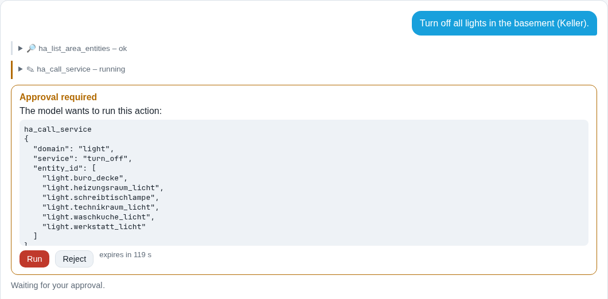
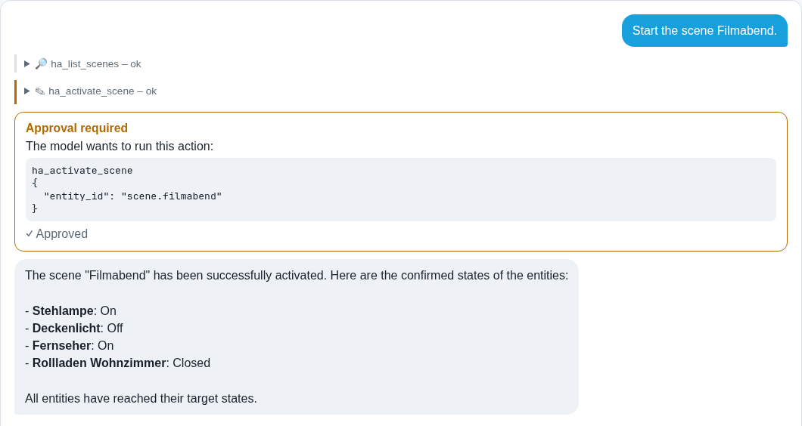
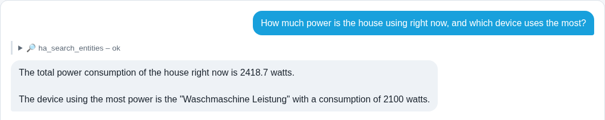
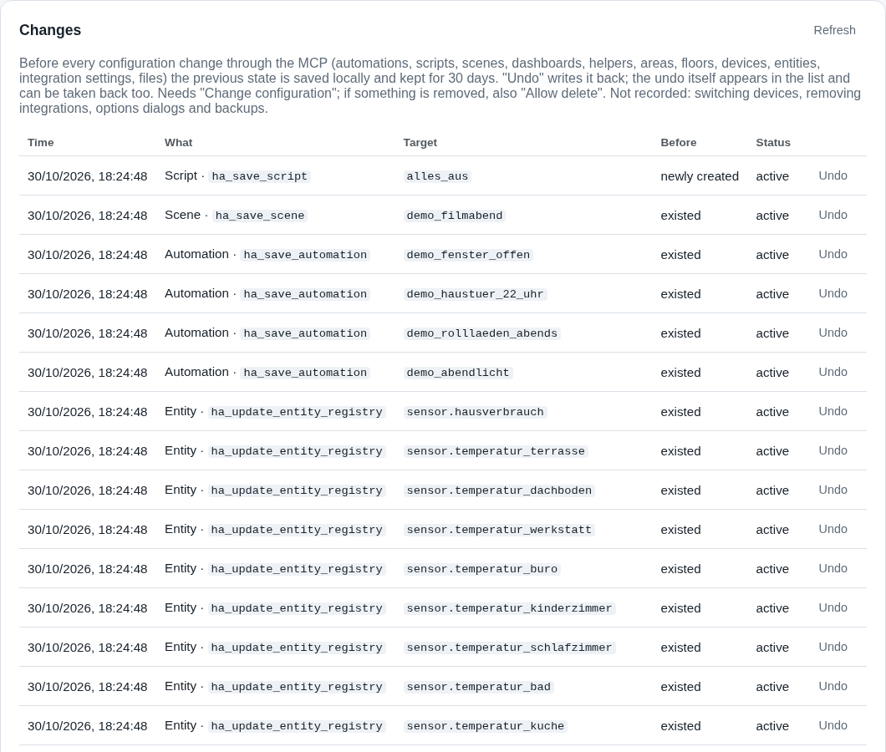

# Home Assistant + local AI, safely

**English** · [Deutsch](README.de.md)

Two projects that let an AI model, even a small one running on your own hardware, help run a Home Assistant home
without handing it the keys:

| Project | What it is | Start here |
|---|---|---|
| [**ha-safe-mcp**](ha-safe-mcp/) | A self-hosted, safety-first [MCP](https://modelcontextprotocol.io/) server for Home Assistant with 161 tools, plus a local web UI with a chat for Ollama models. Every write needs your approval, is read back and lands in a change journal you can undo. | [Feature guide](ha-safe-mcp/docs/FEATURES.md) · [Install](ha-safe-mcp/docs/INSTALL.md) · [User guide](ha-safe-mcp/docs/USER_GUIDE.md) · [Technical docs](ha-safe-mcp/docs/TECHNICAL.md) · [Tool reference](ha-safe-mcp/docs/TOOLS.md) |
| [**ha-diorama**](ha-diorama/) | A copy of the MIT-licensed 3D card [CarlesRojas/ha-diorama](https://github.com/CarlesRojas/ha-diorama) with our additions: real walls (full or half height, near walls cut away), room import from a plan picture, and check tools. Offered upstream. | [Our additions](ha-diorama/hestia/README.md) · [Upstream](ha-diorama/UPSTREAM.md) · [Card docs](ha-diorama/README.md) |

## What it looks like

All pictures come from a demo home on a throwaway Home Assistant (three floors, 17 rooms, 20 lights, 8 switched
devices with power meters, 7 shutters, a door lock, sensors). Nothing in them is a real household. The demo home is
built by [`ha-safe-mcp/scripts/docs_demo_home.py`](ha-safe-mcp/scripts/docs_demo_home.py) and the chat pictures
are taken by [`ha-safe-mcp/scripts/doc_screenshots.py`](ha-safe-mcp/scripts/doc_screenshots.py), so you can
reproduce every one of them.

**A local model switches a whole floor with one approval.** *"Turn off all lights in the basement (Keller)"*:
the model (here `qwen3-coder:30b` on Ollama) lists the lights of every room on that floor in one call and asks
once. Nothing runs before you click *Run*:



**Actions are read back, not assumed.** After the call the MCP reads every target again, so the answer says what
really happened. For a scene it compares each entity with the state stored in the scene:



**Questions in English, a home in German.** Sensors are found by their kind, so *"power"* finds
"Fernseher Leistung" and *"windows"* finds the window contacts:



**Every change can be undone.** The change journal keeps the state before each write:



**The demo home as Home Assistant shows it:**


**ha-diorama with our walls.** The same demo flat with walls (near walls cut away so you can look in) and, below,
as the upstream card draws it:


The [feature guide](ha-safe-mcp/docs/FEATURES.md) walks through all functions with more than 30 such pictures.

## How we build it

| Part | What it does |
|---|---|
| **Dev Home Assistant** | A Home Assistant in Docker with demo devices (lamps, plugs, shutters, sensors). Every new feature is built there first, **through the MCP's own tools**, the way a small model would call them. Where that is clumsy, the MCP gets a better tool or a clearer error, and the round repeats. |
| **A local model as the acceptance test** | A feature counts as done when a local model in the web UI chat does it end to end, verified by the tool output, not by the model's words. |
| **Production** | Only features that passed on dev reach a real home, through a separate MCP instance with its own token and permission switches. Remote access goes through an access proxy; the web UI itself listens on loopback only. |
| **Throwaway instances** | Docs, screenshots and Docker smoke tests run against fresh Home Assistant containers that are deleted afterwards. |
| **Tests** | Over 600 Python tests for ha-safe-mcp (plus smoke tests against a real Home Assistant Core in Docker), tests for the Diorama wall geometry and plan import, and a check that the generated tool reference is up to date. |
| **Diorama on dev** | `ha-diorama/hestia/deploy_dev.py` puts a fresh card build on a test instance next to the HACS copy, and back. |

## Built with an AI agent

These projects are developed by Marius Gehrmann together with **HESTIA**, his AI agent for Home Assistant (built
on the Hermes agent framework). HESTIA writes most of the code, tests and documentation; Marius sets the goals,
reviews the changes and tests them in his own home. Commits authored by HESTIA are AI-generated. Some commits carry
a `Co-Authored-By` line of the language model that HESTIA ran on at the time.

## Quick start

```bash
git clone https://github.com/GehrmannSolutions/HomeAssistant.git
cd HomeAssistant/ha-safe-mcp
python3 -m venv .venv
.venv/bin/python -m pip install -e .
.venv/bin/ha-mcp-ui        # then open http://127.0.0.1:8765/ on the same machine
```

The setup wizard tests your Home Assistant address and token before it saves anything. All writes are off until
you switch them on. Details, Docker and MCP client setup: [installation guide](ha-safe-mcp/docs/INSTALL.md).

## Safety in short

- **Off by default:** control, configuration changes and deletes are separate switches, all off at first.
- **You approve each write** in the web UI chat (approval card with the exact arguments); other MCP clients must
  bring their own confirmation.
- **Read-back:** every action reports per entity whether the expected state was reached.
- **Undo:** writes land in a change journal with the previous state.
- **No secrets in chats or logs:** credentials are encrypted at rest and only referenced, never shown; the audit
  log records which tool ran, never prompts, answers or tokens.
- **The token still matters:** a Home Assistant token keeps its Home Assistant rights whatever the MCP switches
  say. Read [authorization and residual risk](ha-safe-mcp/docs/TECHNICAL.md#authorization-and-residual-risk)
  before you enable writes, and try new things on a test instance first.

## Repository layout

| Path | Content |
|---|---|
| `ha-safe-mcp/` | The MCP server, web UI and chat: source, tests, Docker test setup, examples and docs. Run its commands from this directory. |
| `ha-diorama/` | The Diorama card (upstream copy) with our walls patch; `ha-diorama/hestia/` holds our tests and tools that are not part of the upstream pull request. |
| `docs/showcase/` | The pictures on this page that are not part of a project's own docs. |

## License and credits

[MIT](LICENSE). `ha-diorama/` is a copy of [ha-diorama](https://github.com/CarlesRojas/ha-diorama) by Carles
Rojas, also MIT ([license](ha-diorama/LICENSE)); see [UPSTREAM.md](ha-diorama/UPSTREAM.md) for the exact version and
the [tile credits](ha-diorama/src/tiles/apps/CREDITS.md) for the app logos it ships.

Contributions are welcome: please read [CONTRIBUTING.md](CONTRIBUTING.md) first (no tokens, no household data in
issues or pull requests). Security problems: please use GitHub's private vulnerability reporting instead of a
public issue.
