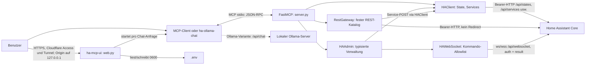

# Technische Dokumentation: ha-safe-mcp

## 1. Geltungsbereich und Grenzen

Diese Dokumentation beschreibt **den implementierten Stand** in `src/ha_safe_mcp/`, nicht alle Fähigkeiten von Home Assistant (HA). Der MCP-Server ist ein lokaler Prozess über **stdio**, kein HTTP-Server und kein allgemeiner Proxy. Getrennt davon gibt es die lokale Weboberfläche `ha-mcp-ui` (§ 8.1). Sie ist ein HTTP-Server auf Loopback, aber **kein** MCP-Endpunkt: Für jede Chat-Anfrage startet sie selbst einen stdio-MCP-Kindprozess. Er bietet einen festen Katalog von REST-Routen, ausgewählte Core-Konfigurationsendpunkte und eine eng begrenzte Menge von Core-/Integrations-WebSocket-Kommandos. `ha_rest_catalog` beschreibt ausschließlich den **im Repository implementierten** Katalog: selbst wenn die aktuelle offizielle REST-Dokumentation weitere Routen oder Query-Parameter nennt, werden diese dadurch nicht automatisch freigeschaltet. Versionsabhängigkeit gilt besonders für die Verwaltungs-APIs. Eine erfolgreiche Konfigurationsoperation beweist weder eine Geräteaktion noch die Ausführung einer Automation.

Begriffe: **read** bedeutet keine vom Adapter beabsichtigte persistente Änderung; ein als read behandelter HTTP-`POST` kann HA-seitig dennoch Admin-Rechte oder rechenintensive Auswertung verlangen. **write** erlaubt nur explizit begrenzte Service-Aufrufe; **admin** umfasst administrative REST- und Konfigurationsänderungen; **delete** verlangt zusätzlich eine separate Löschfreigabe. Die HA-eigenen Benutzerrechte gelten immer zusätzlich zu diesen Adapterklassen.

## 2. Architektur und Datenfluss



1. `server.main()` lädt `.env`, liest `HA_*`, konstruiert `HAClient` und `create_server(...)` und startet `FastMCP.run(transport="stdio")`. Die Tools sind **registriert, auch wenn Writes gesperrt sind**; die Prüfung findet beim Aufruf statt.
2. `HAClient` liest Zustände/Dienste und sendet eingeschränkte Service-POSTs. `RestGateway` prüft zuerst Methode, vollständigen Pfad, Berechtigung, Query und Body; Service-POSTs delegiert es an `HAClient.call_service`.
3. `HAAdmin` kapselt Automationen (Core-Konfigurations-HTTP plus WS-Validierung), Dashboards, Helper und Entity Registry (Core-WebSocket). `HAWebSocket` baut für jeden Befehl eine neue Verbindung auf, erwartet `auth_required`, authentifiziert mit dem HA-Token, sendet genau einen Befehl mit `id=1` und erwartet dessen `result`.
4. Optional fragt `ha-ollama-chat` zunächst die MCP-Toolliste ab, reicht eine thematisch gefilterte Auswahl als Ollama-Funktionsschema weiter, prüft Toolantworten und schickt Ergebnisse an das Modell zurück. **Der HA-Token geht an HA und den lokalen MCP-Kindprozess, nicht als Funktionsschema an Ollama**; Toolergebnisse können allerdings sensible HA-Daten enthalten und gelangen zum konfigurierten Ollama-Endpunkt.
5. `ha-mcp-ui` führt dieselbe Schleife (`run_chat`) in einem Hintergrund-Task aus. Der Browser fragt Ereignisse per Long-Polling ab, und Schreib-Tools warten auf eine Freigabe aus dem Browser statt auf `JA` im Terminal (§ 8.1).

### 2.1 Komponenten- und Dateikarte

| Pfad (relativ zum Repository) | Verantwortung |
|---|---|
| [`src/ha_safe_mcp/server.py`](../src/ha_safe_mcp/server.py) | URL/Token-Prüfung, HTTP-Client, einfache Entity-/Service-Tools, MCP-Registrierung und stdio-Einstiegspunkt |
| [`src/ha_safe_mcp/rest_api.py`](../src/ha_safe_mcp/rest_api.py) | 20 implementierte Methode/Pfad-Muster, Query-Allowlist, Berechtigungsklassen, begrenzte Antwortverarbeitung |
| [`src/ha_safe_mcp/management.py`](../src/ha_safe_mcp/management.py) | WS-Transport, feste Kommando-Typen, typisierte Automation-/Dashboard-/Helper-/Registry-Operationen und Rücklesungen |
| [`src/ha_safe_mcp/ollama_client.py`](../src/ha_safe_mcp/ollama_client.py) | CLI, Tool-Routing, begrenzte Ollama-Schleife, Freigabe pro Write |
| [`src/ha_safe_mcp/web.py`](../src/ha_safe_mcp/web.py) | Weboberfläche: Starlette-App, Loopback-/Host-/CSRF-Schutz, Setup-Prüfungen, Chat-Endpunkte, `ha-mcp-ui`-Einstiegspunkt |
| [`src/ha_safe_mcp/access_auth.py`](../src/ha_safe_mcp/access_auth.py) | Verifikation der Cloudflare-Access-JWT-Assertion (RS256, JWKS, Issuer, Audience, Ablaufdatum) |
| [`src/ha_safe_mcp/config_store.py`](../src/ha_safe_mcp/config_store.py) | Validierung und atomares Schreiben der `.env` (Rechte 0600), Token-Wiederverwendung nur für dieselbe URL |
| [`src/ha_safe_mcp/audit.py`](../src/ha_safe_mcp/audit.py) | DSGVO-orientiertes Audit-Log MCP ↔ HA: Metadaten-Allowlist, Routen-Muster, 30-Tage-Löschung, `clear()` |
| [`src/ha_safe_mcp/files.py`](../src/ha_safe_mcp/files.py) | Dateiablage für vom Modell erzeugte Pläne/Skripte: Namens-Allowlist, kein Symlink-Folgen, 0700/0600, Limits |
| [`src/ha_safe_mcp/chat_runs.py`](../src/ha_safe_mcp/chat_runs.py) | Hintergrund-Chatläufe, geordnete Ereignisse, einmalige Freigaben mit Timeout, Abbruch, maskierte Fehlermeldungen |
| [`src/ha_safe_mcp/webui/`](../src/ha_safe_mcp/webui/index.html) | statisches Frontend (HTML/CSS/JS ohne Framework, ohne Inline-Skripte) |
| [`src/ha_safe_mcp/__main__.py`](../src/ha_safe_mcp/__main__.py) | `python -m ha_safe_mcp` startet den stdio-Server (genutzt für Kindprozesse) |
| [`pyproject.toml`](../pyproject.toml) | Python `>=3.11`, Abhängigkeiten, Entrypoints `ha-safe-mcp`/`ha-ollama-chat`/`ha-mcp-ui`, Paketdaten der Web-UI; pytest-Konfiguration |
| [`Dockerfile`](../Dockerfile), [`compose.test.yaml`](../compose.test.yaml) | schlankes Python-Image für stdio; separater REST-Testdouble auf Host-Port 18123 |
| [`.env.example`](../.env.example), [`README.md`](../README.md) | Konfigurationsvorlage und Kurzüberblick |
| [`tests/test_server.py`](../tests/test_server.py), [`tests/test_rest_api.py`](../tests/test_rest_api.py), [`tests/test_management.py`](../tests/test_management.py), [`tests/test_ollama_client.py`](../tests/test_ollama_client.py) | Unit-/Mock-/WS-Tests |
| [`tests/test_config_store.py`](../tests/test_config_store.py), [`tests/test_chat_runs.py`](../tests/test_chat_runs.py), [`tests/test_web.py`](../tests/test_web.py) | Einstellungen, Chatläufe/Freigaben, HTTP-API der Weboberfläche inkl. Schutzmechanismen |
| [`tests/mock_ha.py`](../tests/mock_ha.py), [`tests/docker_smoke.py`](../tests/docker_smoke.py), [`tests/ha_core_smoke.py`](../tests/ha_core_smoke.py) | REST-Testdouble, Docker-MCP-End-to-End, **destruktiver Onboarding-Smoke nur für frischen Wegwerf-Core** |

## 3. MCP-Tool-Referenz

Signaturen sind die tatsächlichen `@server.tool()`-Funktionsdefinitionen aus `create_server`; Rückgaben sind Python-Typannotationen, wo vorhanden. `dict`-Schemas sind meist nur teilweise durch den Adapter geprüft: die eigentliche Konfigurationsschema-Prüfung liegt bei HA. Alle Tools sind asynchron. `ha_rest_query` ist trotz generischem `method` auf `GET` sowie zwei explizite read-POSTs beschränkt.

| Tool: exakte Signatur | Wirkung und Gate |
|---|---|
| `ha_search_entities(query: str = "", domain: str = "", limit: int = 50) -> list[dict]` | `GET /api/states`, lokale Fall-insensitive Filterung über ID/Friendly Name, kompakte Ausgabe; read |
| `ha_get_state(entity_id: str) -> dict` | vollständiger `GET /api/states/<entity_id>`; read |
| `ha_list_services(domain: str = "") -> list[dict]` | `GET /api/services`, nur Domain und Service-Namen; read |
| `ha_call_service(domain: str, service: str, entity_id: str, service_data: dict \| None = None) -> list[dict]` | POST für eine Entität; `HA_ALLOW_WRITE` und Domain-Allowlist; der interne Client kann auch `return_response=True`, dieses direkte MCP-Tool bietet den Parameter **nicht** |
| `ha_rest_catalog() -> list[dict]` | lokaler Katalog mit `method`, `path`, `permission`; read, keine HA-Anfrage |
| `ha_rest_query(path: str, query: dict \| None = None, method: str = "GET", body: dict \| None = None) -> dict` | katalogisierte GETs, plus `POST /api/template` und `POST /api/config/core/check_config`; Adapterklasse read, HA-Rechte gelten |
| `ha_rest_write(path: str, body: dict \| None = None, query: dict \| None = None) -> dict` | katalogisierter POST; `write` oder `admin` nach Route; **auch** read-POSTs wären hier aufrufbar |
| `ha_rest_delete(path: str) -> dict` | nur katalogisiertes DELETE für State; alle drei Freigaben |
| `ha_validate_automation(config: dict) -> dict` | WS `validate_config`, keine Speicherung |
| `ha_get_automation(config_id: str) -> dict` | Core-Konfigurations-HTTP GET; read |
| `ha_save_automation(config_id: str, config: dict) -> dict` | WS-Validierung, Core-Konfigurations-HTTP POST, GET-Rücklesung; admin |
| `ha_delete_automation(config_id: str) -> dict` | Core-Konfigurations-HTTP DELETE, 404-Rückprüfung; delete |
| `ha_list_dashboards() -> list[dict]` | WS-Dashboardliste; read |
| `ha_get_dashboard(url_path: str = "") -> dict` | WS-Lovelace-Konfiguration; Leerstring wählt Standard-Dashboard; read |
| `ha_create_dashboard(title: str, url_path: str) -> dict` | WS-Erstellung, Sichtbarkeit in Liste; admin |
| `ha_save_dashboard(config: dict, url_path: str = "") -> dict` | WS-Konfigurationsspeicherung, exakte Rücklesung, `{"previous": ..., "config": ...}`; admin |
| `ha_list_helpers(domain: str) -> list[dict]` | WS-Collection-Liste; read |
| `ha_create_helper(domain: str, config: dict) -> dict` | WS-Erstellung, ID-Sichtbarkeit in Liste; admin |
| `ha_update_helper(domain: str, helper_id: HelperId, config: dict) -> dict` | WS-Update nach Collection-ID, Name-Rücklesung; admin |
| `ha_delete_helper(domain: str, helper_id: HelperId) -> None` | WS-Löschen, Abwesenheit in Liste; delete |
| `ha_update_dashboard(dashboard_id: str, changes: dict) -> dict` | WS-Metadaten-Update nach Collection-ID mit Feldvergleich; admin |
| `ha_delete_dashboard(dashboard_id: str) -> None` | WS-Löschen nach Collection-ID mit Listenprüfung; delete |
| `ha_list_entity_registry() -> list[dict]` | WS-Registry-Liste; read |
| `ha_update_entity_registry(entity_id: str, changes: dict) -> dict` | WS-Update von `name`, `area_id`, `icon` mit Feldvergleich; admin; **keine Entity-Erstellung** |
| `ha_list_integrations(domain: str = "") -> list[dict]` | `GET /api/config/config_entries/entry[?domain=]`, reduziert auf `entry_id`, `domain`, `title`, `state`, `source`, `disabled_by`, `reason`; read |
| `ha_list_integration_types(query: str = "") -> list[str]` | `GET /api/config/config_entries/flow_handlers`, gefiltert, höchstens 100; read |
| `ha_list_discovered() -> list[dict]` | WS `config_entries/flow/progress` (nur nicht vom Nutzer gestartete Flows, z. B. zeroconf); read; **kein eigener Netzwerkscan** |
| `ha_list_credentials() -> list[dict]` | lokale Zugangsdatenablage: Alias, Bezeichnung, Feldnamen; **nie Werte**; keine HA-Anfrage |
| `ha_start_integration_setup(handler: str, show_advanced_options: bool = False) -> dict` | `POST /api/config/config_entries/flow`; admin; Ergebnis reduziert (Formular, `flow_id`) |
| `ha_integration_setup_step(flow_id: FlowId, data: dict \| None = None) -> dict` | `POST /api/config/config_entries/flow/<flow_id>`; admin; Geheimfelder nur als `$credential`-Verweis; Werte werden erst hier aufgelöst und aus jedem Ergebnis entfernt |
| `ha_abort_integration_setup(flow_id: FlowId) -> dict` | `DELETE /api/config/config_entries/flow/<flow_id>`; admin |
| `ha_reload_integration(entry_id: EntryId) -> dict` | `POST /api/config/config_entries/entry/<entry_id>/reload`; admin |
| `ha_delete_integration(entry_id: EntryId) -> dict` | `DELETE /api/config/config_entries/entry/<entry_id>`; delete |

### 3.1 Integrationen und Zugangsdatenablage

Quelle der Routen: `homeassistant/components/config/config_entries.py` und `homeassistant/helpers/data_entry_flow.py` im offiziellen Core-Repository; Flow-Start, -Schritt und Entry-Löschen verlangen in HA selbst einen Admin-Benutzer. `FlowId` akzeptiert die 32-stellige Hex-Form älterer Releases und die 26-stellige ULID aktueller Releases (im Dev-HA beobachtet); `EntryId` 20–40 alphanumerische Zeichen. Beides wird vor jeder Anfrage geprüft, Pfad-Traversal ist dadurch ausgeschlossen.

**Geheimfelder.** Felder, deren Name `pass`, `secret`, `token`, `api_key`, `pin`, `auth`, `credential` oder `private` enthält, werden nur als `{"$credential": "<alias>", "field": "<feld>"}` angenommen; Klartext wird vor dem Netzwerkzugriff abgelehnt. `integrations.py` löst den Verweis unmittelbar vor `POST` auf, ersetzt danach jedes Vorkommen des Werts in Ergebnis und Fehlertext durch `[credential:<alias>.<feld>]` und entfernt `default`/`suggested_value` von Geheimfeldern im zurückgegebenen `data_schema`. Harmlose Defaults (z. B. Port 80) bleiben sichtbar, damit das Modell keine Werte erfindet. Flow-Schritte haben 90 s Timeout, weil Geräte-Handshakes länger dauern als die üblichen 15 s.

**Zugangsdatenablage** (`credentials.py`). Fernet-verschlüsselt in `$XDG_CONFIG_HOME/ha-safe-mcp/credentials/` (Standard `~/.config/…`), Ordner 0700, `store.key` und `store.bin` 0600, atomar geschrieben. Der Schlüssel liegt neben den Daten: Das schützt vor versehentlicher Offenlegung (Backups, Screenshots, `cat`, Commits), nicht vor jemandem mit Shell-Zugriff auf diesen Benutzer. Die Weboberfläche verwaltet die Ablage über `GET/POST /api/credentials` und `DELETE /api/credentials/<alias>` (gleiche Host-, Peer-, Header-, Origin- und Access-Prüfungen wie alle anderen Routen); keine Route gibt Werte zurück, leere Felder beim Ändern behalten den gespeicherten Wert. Der MCP-Kindprozess erhält nur `HA_CREDENTIALS_DIR`, nicht die Werte. `POST /api/chat` lehnt Nachrichten (und Nutzer-Verlauf) mit Mustern wie `pw:`, `Passwort ist …`, `password=…`, `token:` ab, bevor das Modell sie sieht; die Oberfläche übernimmt abgelehnte Nachrichten nicht in den gespeicherten Verlauf.

Das `ha_rest_*`-Ergebnis hat bei normalen Antworten `{"status": HTTP-Code, "content_type": MIME-Typ, "data": ...}`; Bildantworten haben statt `data` das Feld `data_base64`. Service-POSTs erhalten einen synthetischen Wrapper mit `status: 200` und `content_type: application/json`, weil sie über `HAClient.call_service` laufen. Direkte Tools geben die jeweiligen HA-Daten ohne diesen Wrapper zurück. MCP-Toolfehler werden vom SDK als Tool-Fehler gemeldet, nicht als bestätigte Zustandsänderung.

## 4. REST-Katalog: Methode, Route und Adapterklasse

Quelle der **implementierten** Liste ist `ROUTES` in [`rest_api.py`](../src/ha_safe_mcp/rest_api.py). Die Platzhalter in spitzen Klammern sind Dokumentation, keine wörtlich übergebenen Pfade. Muster werden mit `re.fullmatch` auf den gesamten übergebenen Pfad geprüft. `read` = ohne Adapter-Write-Schalter; `write` = `HA_ALLOW_WRITE`; `admin` = zusätzlich `HA_ALLOW_ADMIN_WRITE`; `delete` = zusätzlich `HA_ALLOW_DELETE`. Die HA-eigenen Berechtigungen sind **nicht** aus der Adapterklasse ableitbar: Beispielsweise verlangen `POST /api/template`, `POST /api/config/core/check_config` und `GET /api/error_log` im [Core-API-Code](https://github.com/home-assistant/core/blob/dev/homeassistant/components/api/__init__.py) bzw. [Core-Konfigurationscode](https://github.com/home-assistant/core/blob/dev/homeassistant/components/config/core.py) Admin-Rechte, obwohl der Adapter sie als `read` klassifiziert. Vor einem Einsatz gegen eine andere HA-Version deren tatsächliche Autorisierung prüfen.

| Methode | Pfad im Katalog | Klasse | Besonderheit |
|---|---|---|---|
| GET | `/api/` | read | Slash am Ende erforderlich |
| GET | `/api/config` | read | Core-Konfigurationsübersicht |
| GET | `/api/components` | read | geladene Komponenten |
| GET | `/api/events` | read | Eventtypen/Listener |
| GET | `/api/services` | read | registrierte Aktionen |
| GET | `/api/history/period[/<timestamp>]` | read | `filter_entity_id` erforderlich; optionaler Zeitstempel mit begrenztem Syntaxmuster |
| GET | `/api/logbook[/<timestamp>]` | read | optionaler Zeitstempel |
| GET | `/api/states` | read | Zustandsliste |
| GET | `/api/states/<entity_id>` | read | einzelner Zustand |
| GET | `/api/error_log` | read | HA-seitig Admin; Textantwort |
| GET | `/api/camera_proxy/<camera_entity_id>` | read | nur `camera.<slug>`; Bild als Base64 |
| GET | `/api/calendars` | read | Kalenderliste |
| GET | `/api/calendars/<calendar_entity_id>` | read | nur `calendar.<slug>`; `start` und `end` erforderlich |
| POST | `/api/states/<entity_id>` | admin | `state` im Body erforderlich; setzt nur Laufzeit-State, **keine persistente Entity** und kein Gerätekommando |
| POST | `/api/events/<event_type>` | admin | Event auslösen |
| POST | `/api/services/<domain>/<service>` | write | via `call_service`; eine `entity_id`, Domain-Allowlist und kein alternatives Target |
| POST | `/api/template` | read | HA-seitig Admin; Template-Auswertung ist keine allgemeine Garantie von Nebenwirkungsfreiheit |
| POST | `/api/config/core/check_config` | read | HA-seitig Admin; Konfigurationsprüfung, nicht Automation-Speicherung |
| POST | `/api/intent/handle` | admin | Intent-Bearbeitung; Wirkung hängt von HA-Intent ab |
| DELETE | `/api/states/<entity_id>` | delete | entfernt nur den State, nicht die zugrunde liegende Integration |

Zugelassene Query-Schlüssel (Werte müssen `str`, `int` oder `bool` sein; Listen und `None` abgelehnt): `/api/history/period*`: `filter_entity_id`, `end_time`, `minimal_response`, `no_attributes`, `significant_changes_only`; `/api/logbook*`: `entity`, `end_time`; `/api/calendars/<entity>`: `start`, `end`; `/api/camera_proxy/*`: `time`; `/api/services/*`: `return_response`. Alle anderen Query-Schlüssel werden abgelehnt, auch wenn HA sie inzwischen dokumentiert. Für History muss `filter_entity_id` truthy sein; für Kalender müssen beide Zeitgrenzen als Schlüssel vorhanden sein. Bei Service-POST zählt **die Präsenz** von `return_response`, nicht dessen Bool-Wert: auch `false` führt zu `?return_response` im internen Client. Das Service-Ergebnis kann dann statt einer Liste ein Objekt mit `changed_states` und `service_response` sein, obwohl die direkte Tool-Signatur `list[dict]` angibt.

`RestGateway` erlaubt JSON-Objekt-Bodies bis zur Grenze `len(str(body).encode()) <= 65536` (kein exakter JSON-Bytezähler). Bei Nicht-Service-REST werden HTTP-Redirects nicht gefolgt, Proxy-Umgebungsvariablen ignoriert, ein 20-s-Timeout gesetzt und die **bereits geladene** Antwort auf höchstens 2.000.000 Bytes geprüft. Die Grenze verhindert nicht das vorherige Herunterladen einer großen Antwort; Base64-Ausgabe ist größer als das Binäroriginal. Für `HAClient._request` (einfache Tools und Automation-HTTP) gelten dagegen 15 s und **keine** entsprechende Body-/Response-Grenze; diese Unterschiede sind sicherheitsrelevant. `response.json()` wird für Nicht-Text-/Nicht-Bildantworten erwartet.

### 4.1 Drei verschiedene API-Oberflächen

- **Öffentliche REST-Referenz**: genau die oben implementierten `/api/...`-Routen; HA-REST-Dokumentation ist die fachliche Referenz, nicht die automatische Allowlist. `POST /api/config/core/check_config` ist ein Prüfendpunkt der Core-Konfiguration, **nicht** der Automation-Konfigurations-CRUD.
- **Core-Konfigurations-HTTP**: `GET`, `POST`, `DELETE /api/config/automation/config/{config_id}` in `HAAdmin`. Diese Route steht **nicht** in `ROUTES`, ist also nicht über `ha_rest_query`/`write`/`delete` zugänglich. Sie dient dem Speicher-CRUD einer Automation, nicht dem flüchtigen `POST /api/states`.
- **WebSocket**: `/api/websocket`, mit fest erlaubten `type`-Werten; keine REST-Methode, kein freier WS-Proxy. Validierung `validate_config` läuft hier. Dashboard-/Helper-/Registry-Operationen ebenfalls. Diese Core-/Integrationskommandos können zwischen Core-Versionen abweichen.

## 5. WebSocket-Kommando-Allowlist und Verwaltung

Die Mengen `READ_TYPES`, `WRITE_TYPES`, `DELETE_TYPES` in [`management.py`](../src/ha_safe_mcp/management.py) gelten **auch bei direktem Aufruf von `HAWebSocket.command`**. Schreib- und Löschkommandos verlangen die entsprechenden Gates. Die öffentlich registrierten Tools bieten **keinen** frei wählbaren WS-Typ.

| Klasse | exakt erlaubte `type`-Werte |
|---|---|
| READ | `validate_config`, `lovelace/config`, `lovelace/dashboards/list`, `config/entity_registry/list`, `auth/current_user` sowie `input_boolean/list`, `input_number/list`, `input_select/list`, `input_text/list`, `input_datetime/list` |
| WRITE | `lovelace/config/save`, `lovelace/dashboards/create`, `lovelace/dashboards/update`, `config/entity_registry/update` sowie je `input_boolean`, `input_number`, `input_select`, `input_text`, `input_datetime` die Suffixe `/create` und `/update` |
| DELETE | `lovelace/config/delete`, `lovelace/dashboards/delete`, `config/entity_registry/remove` sowie je Helper-Domain das Suffix `/delete` |

`lovelace/config/delete` und `config/entity_registry/remove` stehen **transportseitig** in der Allowlist, werden aber von keinem veröffentlichten MCP-Tool aufgerufen; insbesondere existiert kein MCP-Registry-Delete. `auth/current_user` nutzt nur die Ersteinrichtung der Weboberfläche über `HAAdmin.current_user()`; zurückgegeben werden ausschließlich `name`, `is_owner` und `is_admin`, keine IDs und keine MFA-Details. Ein MCP-Tool dafür gibt es nicht. Neue WS-Kommandos nicht allein durch `READ_TYPES`/`WRITE_TYPES` verfügbar machen: sie brauchen ein typisiertes API, Validierung, Berechtigungstests und Core-Integrationstest. Eine WS-Nachricht darf im Payload weder `id`, `type` noch `access_token` überschreiben; JSON-kodierter Payload maximal 65.536 Bytes. Empfangslimit pro WS-Nachricht 2.000.000 Bytes, Connect-Timeout 10 s, gesamter Austausch 20 s. Für HTTP(S) wird WS(S) derselben Authority benutzt. Keine Subscriptions oder automatischen Wiederholungen.

### 5.1 Eingabevalidierung nach Objekttyp

- `HA_URL`: nur Root-`http://` oder `https://` mit Host, ohne Zugangsdaten, Pfad außer `/`, Query oder Fragment; Token darf nicht leer sein. Das ist **keine** Host-/Netzwerk-Allowlist: ein konfigurierter fremder Host empfängt den Token. HTTPS-Zertifikate werden nicht abgeschaltet.
- Identifikatoren für Domain/Service: `^[a-z][a-z0-9_]*$`; Entity-ID: `^[a-z][a-z0-9_]*\.[a-z0-9_]+$`. `search_entities` limitiert `limit` auf 1–200, filtert lokale Zustandsliste und ist nicht serverseitig paginiert. Weder Regex noch Konfigurationsprüfungen garantieren semantisch gültige HA-Objekte.
- Service: zuerst Write-Gate und konfigurierter Domainabgleich (standardmäßig `light`, `switch`, `fan`, `climate`, `cover`, `media_player`), dann gültige ID und identische Domain von `entity_id`. `service_data` muss ein Objekt sein, ohne eigene Schlüssel `entity_id`, `area_id`, `device_id`; **verschachtelte** Targets oder andere service-spezifische Felder werden nicht tief geprüft. `ha_call_service` reicht keinen `return_response`-Parameter durch.
- Automation: `config_id` entspricht `[a-zA-Z0-9_-]{1,64}`. Validierung nimmt nur vorhandene `triggers`, `conditions`, `actions`, mindestens eines davon, und sendet diese über WS `validate_config`; andere Konfigurationsfelder werden dabei nicht validiert. Speichern verlangt ein nichtleeres String-`alias` und verbietet `id` im Payload. Wenn die zurückgelieferte Validierungsstruktur als Mapping für einen Eintrag `{valid: false}` liefert, wird abgebrochen; keine vollständige semantische Prüfung von HA oder aller Konfigurationsfelder.
- Dashboard: `url_path` bei Erstellung bzw. expliziter Speicherung `^[a-z0-9]+(?:-[a-z0-9]+)+$` (mindestens ein Bindestrich); Titel muss truthy sein. `save` verlangt `config` als Objekt mit `views`-Liste. Der leere MCP-`url_path` bezeichnet das Standard-Dashboard. Metadaten-Update akzeptiert nur `title`, `icon`, `require_admin`, `show_in_sidebar`; ID `[a-z][a-z0-9_]{0,63}`. Werte werden nicht lokal typisiert, HA prüft sie.
- Helper: nur `input_boolean`, `input_number`, `input_select`, `input_text`, `input_datetime`. Create braucht einen nichtleeren String-`name`; `input_number` braucht `min` und `max`, `input_select` eine nichtleere `options`-Liste, `input_datetime` `has_date` oder `has_time`. `id`, `entity_id`, `type` sind gesperrt. Update verlangt volle Konfiguration mit `name`, sperrt zusätzlich `<domain>_id`; Collection-ID `[a-z][a-z0-9_]{0,63}`. Die domänenspezifischen Create-Prüfungen werden bei Update **nicht erneut lokal ausgeführt**; HA prüft den Rest.
- Registry-Update: gültige Entity-ID, nichtleeres `changes`-Objekt mit ausschließlich `name`, `area_id`, `icon`; aktualisiert bestehende Registry-Einträge, nicht Entitäten oder Geräte selbst.

## 6. Authentifizierung, Umgebung und Sicherheitsmodell

| Einstellung | Standard | Bedeutung |
|---|---|---|
| `HA_URL` | `http://127.0.0.1:8123` | HA-Root-URL aus Sicht **des Serverprozesses/Containers** |
| `HA_TOKEN` | leer → Startfehler | HA-Long-Lived-Access-Token; HTTP-Bearer, WS-`auth` |
| `HA_ALLOW_WRITE` | `false` | nur exakter case-insensitiver Wert `true` aktiviert Service-/REST-Writes |
| `HA_ALLOW_ADMIN_WRITE` | `false` | zusätzlich zum vorherigen Gate administrative REST-/Verwaltungs-Writes |
| `HA_ALLOW_DELETE` | `false` | zusätzlich zu beiden Gates Löschoperationen |
| `HA_ALLOWED_DOMAINS` | `light,switch,fan,climate,cover,media_player` | kommaseparierte erlaubte Service-Domains; gilt für `ha_call_service` **und** REST-Service-POST, nicht für alle REST-Adminrouten |

`load_dotenv()` lädt `.env` am Einstieg; bestehende Umgebungsvariablen haben bei `python-dotenv` standardmäßig Vorrang. Ein Admin-Token ist für administrative HA-Funktionen notwendig, aber nicht jeder Adapter-read ist für einen Nicht-Admin-Token tatsächlich ausführbar. `.env` schützen; keine Token in Modellprompts, Logs, Shell-Verlauf oder Repository ablegen. `trust_env=False` deaktiviert HTTP(S)-Proxy-Umgebungsvariablen bei httpx-Clients (HA und Ollama); WS hat hier keine identische explizite `trust_env`-Einstellung. Lokaler stdio-Zugriff ist die Vertrauensgrenze; wer den MCP-Client und Prozess-Environment kontrolliert, kann erlaubte Tools auslösen.

**Schrankenfolge für einen Write:** lokale Tool-/Methodenwahl → Methoden-/Pfad-Allowlist und Datenprüfung → `HA_ALLOW_WRITE` → für `admin` zusätzlich `HA_ALLOW_ADMIN_WRITE` → für `delete` zusätzlich `HA_ALLOW_DELETE` → HA-Token und HA-seitige Autorisierung. Für Ollama gilt außerdem `--allow-write` **und** interaktives `JA` für **jeden** als `WRITE_TOOLS` klassifizierten Aufruf. Diese letzte Bestätigung existiert nur in diesem CLI, nicht generell im MCP-Server. Sie gilt auch nicht für `ha_rest_query` mit den beiden erlaubten POSTs: die sind als Lesetools klassifiziert. Andere MCP-Clients müssen ihre eigene Freigabepolitik implementieren.

### 6.1 Bedrohungen und Restgefahren

| Bedrohung | Vorhandene Schranke | Restgefahr / Maßnahme |
|---|---|---|
| Prompt Injection durch HA-Attribute, Template-/Log-Ausgaben oder Modellantwort | Systemtext: Tool-Ausgaben sind Daten; Tool-Allowlist, Write-Gates und manuelles CLI-`JA` | Modell kann falsche Handlung vorschlagen; Payload vor `JA` prüfen, read-only als Standard verwenden |
| URL-/Pfad-Injektion, Traversal, offene Proxy-Routen | feste `ROUTES`, `re.fullmatch`, reservierte WS-Felder | `HA_URL` selbst kann auf anderen Host gesetzt werden; Zielserver, DNS und Tokenablage absichern |
| Überbreite Aktionen | Service-Domain- und Entity-ID-Match, verbotene Top-Level-Targets | Service-Daten nicht tief geprüft; HA-Dienste können intern weitere Wirkung haben; produktive Token-Rechte begrenzen |
| Unbeabsichtigte Adminänderung | dreistufige Gates und HA-Rechte | Event-/Intent-POSTs können Folgen außerhalb des Adapters auslösen; Admin-/Löschfreigaben nur zeitweilig aktivieren |
| Datenabfluss / Speicherüberlastung | REST-Antwortlimit, kompakte Suchausgabe, Ollama-Ergebnis-Trim auf 6000 Zeichen | einfache HAClient-Antworten ohne Größenlimit; REST-Limit erst nach Download; Modell bekommt relevante Toolinhalte; Ollama-URL vertrauenswürdig halten |
| Teilweise Mutation / Race | Rücklesung bei ausgewählten Verwaltungs-Tools | Prüfung ist keine atomare Transaktion und kein Rollback; zwischen Schreiben und Lesen kann HA oder ein anderer Client ändern |

Der Adapter ist **keine Sandbox** für Jinja-Templates, HA-Services oder ein Admin-Konto. Der Server bietet weder Multi-User-Isolation noch eigene Authentifizierung vor stdio, Audit-Log, Request-Ratenlimit, vollständige Schema-Typisierung oder automatische Sicherung/Rücksetzung.

## 7. Rücklesung, Fehler und Betriebssemantik

| Operation | tatsächlich geprüfte Nachbedingung |
|---|---|
| Automation speichern | WS-Validierung ausgewählter Felder, POST-Ergebnis `result == "ok"`, GET mit gleicher `id` und gleichem `alias` |
| Automation löschen | DELETE, danach GET muss **genau** HTTP 404 ergeben |
| Dashboard erstellen | `url_path` muss in WS-Dashboardliste auftauchen |
| Dashboard-Konfiguration speichern | vorige Konfiguration lesen (nur `config_not_found` wird zu `None`), speichern, GET-Konfiguration muss dem übergebenen `config` **exakt** entsprechen; `previous` ist nur manuelle Rollback-Hilfe |
| Dashboard-Metadaten aktualisieren/löschen | Metadatenfelder nach List-Aufruf vergleichen bzw. ID aus Liste verschwunden |
| Helper erstellen/aktualisieren/löschen | zurückgegebene ID in Liste / `name` in Liste / ID nicht mehr in Liste |
| Registry aktualisieren | angegebene Felder in Listeneintrag vergleichen |
| Dienst, REST-State/Event/Intent | keine unabhängige Persistenz- oder Geräte-Rückprüfung; HTTP-Ergebnis allein |

**Keine Garantie:** Die Rücklesungen vergleichen nicht überall die gesamte Konfiguration (Automation nur ID/Alias; Helper-Update nur Name; Dashboard-Create nur URL-Pfad). Exact-Match bei Dashboard-Save kann an Core-Normalisierung scheitern, obwohl gespeichert wurde. Ein Fehler **nach** erfolgreichem Write kann einen veränderten HA-Zustand hinterlassen; es gibt keinen automatischen Rollback oder idempotente Retry-Logik. Automation-Reload erfolgt Core-seitig asynchron; gespeicherte Automation heißt nicht ausgelöst/sofort lauffähig. Registry-Update schafft keine neue Entity, REST-State-POST keine persistente Integration. Dashboard- und Helper-IDs sind Collection-IDs, nicht beliebige Anzeige- oder Entity-IDs.

HTTP-Statusfehler werden ohne Response-Body als `RuntimeError("Home Assistant returned HTTP <code>")` gemeldet; Netzwerk-/JSON-Fehler als Typname ohne Token/Body. WS meldet ungültige Auth-Phase, nichtpassende `result`-ID oder `success=false`; aus Core-Fehlern wird nur ein auf `[a-z_]{1,60}` reduzierter Code angezeigt, keine Server-Nachricht. Timeouts/Transport-/JSON-Fehler werden gekapselt. Lokale Validierungs-/Gatefehler sind `ValueError`; abgelehnte CLI-Bestätigung `PermissionError`. Andere Fehler (z. B. unerwartete Antwortform, fehlendes Mapping) sind nicht generell abgefangen und sollten nicht als erfolgreiche Mutation interpretiert werden. Bei Timeout nach Write nicht blind erneut senden: erst HA-Zustand separat prüfen.

## 8. Ollama-Modellrouting

`ha-ollama-chat` nimmt einen Prompt sowie optional `--model` (Standard `qwen2.5-coder:7b`), `--ollama-url` (Standard `http://127.0.0.1:11434`) und `--allow-write`. `mcp_parameters()` startet über `mcp_parameters_for(env)` den Server als `<aktueller Python> -m ha_safe_mcp` mit Projekt-`cwd` und reicht nur vorhandene `HA_URL`, `HA_TOKEN`, `HA_ALLOW_WRITE`, `HA_ALLOW_ADMIN_WRITE`, `HA_ALLOW_DELETE`, `HA_ALLOWED_DOMAINS` als explizites Kindprozess-Environment weiter; `.env` kann über das Projekt-`cwd` vom Server nachgeladen werden. Die Weboberfläche übergibt dagegen **alle sechs** Werte aus `Settings.mcp_env()`; explizit gesetzte Variablen haben bei `python-dotenv` Vorrang vor der `.env`. Andere Variablen (z. B. GitHub-PAT) werden nicht absichtlich weitergereicht. Das ist kein allgemeiner Container-/Secrets-Isolationsmechanismus.

`select_tool_names(prompt, available, allow_write=...)` beginnt mit `ha_search_entities` und `ha_get_state`, ergänzt Regex-Themen (Automation, Dashboard, Helper, Registry, REST/History/Template/Event, Schalten/Service) und ausdrücklich im Prompt genannte Toolnamen. Es bildet die Schnittmenge mit tatsächlich gelisteten Tools und `READ_TOOLS`, bei `--allow-write` zusätzlich `WRITE_TOOLS`. Diese Schlüsselwortheuristik kann passende Tools **auslassen** oder unpassende anbieten; expliziten Toolnamen verwenden. Die lesende `ha_rest_query` kann read-POSTs aufrufen, nicht beliebige Mutationen. Das Modell erhält eine Ollama-`/api/chat`-Anfrage mit Tool-Schemas und `stream: false`; höchstens vier Schleifenrunden, pro Tool-Text höchstens 6000 Zeichen, HTTP-Timeout 180 s. Neben nativen `tool_calls` wird ein alleinstehendes JSON-Objekt `{"name": ..., "arguments": {...}}` im Modelltext als Tool-Vorschlag akzeptiert, aber nur für ausgewählte Namen; nicht freigegebene Schreibvorschläge werden abgelehnt. Bei `WRITE_TOOLS` zeigt die CLI Name und Payload und verlangt wortwörtlich `JA` **pro** Aufruf. Bei erreichten vier Runden kommt ein Fehler statt einer angeblich verifizierten Antwort. Modellantworten sind keine verlässlichen HA-Messwerte; aktuelle Zustände immer durch Toolresultate absichern.

**Schema-Prüfung vor der Freigabe:** `HelperId` ist ein `str` mit Pattern `^[a-z][a-z0-9_]{0,63}$` und einer Beschreibung im Tool-Schema (Collection-ID aus `ha_list_helpers`, nicht Anzeigename oder `entity_id`). Bevor eine Freigabe-Karte erscheint, prüft `_schema_problem` jeden **Schreib**vorschlag mit `jsonschema` gegen das Schema des Tools. Ein Verstoß geht als Tool-Ergebnis „Ungültige Argumente, nichts ausgeführt …“ zurück an das Modell, das in derselben Runde korrigieren kann; der Nutzer sieht dafür keine Karte. Lesevorschläge werden nicht vorgeprüft, weil die serverseitige Pydantic-Validierung Typen umwandelt (z. B. `"10"` → `10`).

**Leere Toolergebnisse:** FastMCP überträgt eine leere Liste oder `None` als null Textblöcke. `_tool_text` reicht dem Modell dann das strukturierte Ergebnis mit einem ausdrücklichen Erfolgsvermerk weiter (z. B. „[] (Erfolgreich: die Liste ist leer …)“), weil ein leerer String von kleinen Modellen als Fehlschlag gelesen wird. **Nur-Lese-Chat:** Ohne `allow_write` ergänzt `READ_ONLY_HINT` den Systemprompt: Bei Anlege-, Änderungs-, Schalt- oder Löschwünschen soll das Modell auf das Häkchen „Aktionen erlauben“ verweisen, statt Befehle oder JSON zu erfinden. Blockierte Schreibvorschläge enden mit derselben Handlungsanweisung.

`run_chat(..., history=None, on_event=None)` nimmt außerdem einen Verlauf und einen Ereignis-Callback an. `sanitize_history` lässt nur `user`/`assistant`-Nachrichten mit Text zu (sonst `ValueError`), kürzt jede auf 4000 Zeichen und behält die letzten zwölf; System- und Tool-Rollen aus dem Client sind ausgeschlossen. `approve` darf synchron oder `async` sein; nur ein Rückgabewert, der **identisch `True`** ist, gibt frei. `on_event` erhält `thinking` (pro Runde), `tool_call` (`name`, `arguments`, `write`) und `tool_result` (`name`, `ok`, `preview` mit höchstens 300 Zeichen).

### 8.1 Weboberfläche `ha-mcp-ui`

**Start:** `ha-mcp-ui [--host 127.0.0.1] [--port 8765] [--env-file PFAD] [--allow-remote] [--public-host HOSTNAME]`. Ohne `--env-file` wird die `.env` im Projekt verwendet. `guard_bind_host` beendet den Start bei einer Nicht-Loopback-Adresse ohne `--allow-remote`. `--public-host` verlangt Loopback-Bindung **ohne** `--allow-remote`, `CF_ACCESS_AUD` und `CF_ACCESS_TEAM_DOMAIN` (HTTPS-Team-Domain); die HTTP-Host-Allowlist beschränkt sich dann auf den öffentlichen Hostnamen. Uvicorn läuft ohne Proxy-Header-Auswertung und ohne `Server`-Header. Der hier eingesetzte systemd-Benutzerdienst nutzt eine separate 0600-EnvironmentFile unter `~/.config/ha-safe-mcp/access.env` und leitet ausschließlich über den Cloudflare-Tunnel auf `127.0.0.1:8765` weiter, ohne ufw-Portöffnung.

**Schutzschicht `LocalOnlyGuard` (ASGI, vor jeder Route):**

| Prüfung | Antwort bei Verstoß | Zweck |
|---|---|---|
| `Host`-Header ist lokal `localhost`, `127.0.0.1` oder `::1`; im Public-Modus **nur** der konfigurierte öffentliche Hostname | 400 | DNS-Rebinding |
| Gegenstelle ist Loopback (entfällt mit `--allow-remote`) | 403 | kein Zugriff aus dem LAN |
| Im Public-Modus: signierte `Cf-Access-Jwt-Assertion` mit RS256, verifiziert anhand der Team-JWKS; `iss`, `aud`, `iat`, `exp` werden geprüft | 403 | kein Zugriff ohne gültige Cloudflare-Access-App-Anmeldung, auch nicht über eine lokale Origin-Verbindung; ungültige/offline JWKS scheitern geschlossen |
| Bei jeder Methode außer GET/HEAD: Header `X-HA-MCP-UI: 1`, und ein vorhandener `Origin` ist lokal exakt `<scheme>://<host>`, im Public-Modus exakt `https://<public-host>` | 403 | CSRF: einfache Cross-Site-Formulare können keinen eigenen Header setzen, fremde Fetches scheitern am Origin bzw. am CORS-Preflight |

Alle Antworten tragen `Content-Security-Policy` (`default-src 'self'`, keine Inline-Skripte, `frame-ancestors 'none'`), `X-Frame-Options: DENY`, `X-Content-Type-Options: nosniff`, `Referrer-Policy: no-referrer` und `Cache-Control: no-store`. Request-Bodys sind auf 64 KiB begrenzt, Chatnachrichten auf 4000 Zeichen.

**HTTP-API** (alle JSON; Fehler als `{"error": "<deutscher Text>"}`):

| Methode und Pfad | Wirkung |
|---|---|
| `GET /api/status` | `configured`, `settings` (öffentliche Sicht mit `token_set` statt Token), `chat_busy` |
| `POST /api/setup/test-ha` | `{ha_url, token}`; ein leerer Token nutzt den gespeicherten, aber nur für dieselbe URL. Prüft nur lesend und speichert nichts |
| `POST /api/setup/test-ollama` | `{ollama_url}`; liefert Version und Modelle mit `size_gb` und `tools` (aus `/api/show` → `capabilities`) |
| `POST /api/setup`, `POST /api/settings` | validieren (`merge_settings`), HA-Verbindung prüfen, „Konfiguration ändern“ nur bei `is_admin`, dann atomar speichern. Bei fehlgeschlagener Prüfung wird nichts geschrieben |
| `POST /api/chat` | `{message, history, allow_write}` → `{run_id}`. 409 vor der Einrichtung oder wenn bereits eine Anfrage läuft; `allow_write` nur, wenn „Steuern“ gespeichert ist |
| `GET /api/chat/{run_id}/events?after=N&wait=S` | Long-Polling (`wait` ≤ 25 s): Ereignisse mit `seq` > `after` |
| `POST /api/chat/{run_id}/approve` | `{approval_id, approved}`; 404, wenn die Freigabe nicht oder nicht mehr offen ist (einmalig) |
| `POST /api/chat/{run_id}/cancel` | bricht den Lauf ab und lehnt offene Freigaben ab |
| `GET /api/files` | Liste `{kind, name, size, modified}` der gespeicherten Pläne (`plan`) und Skripte (`script`) |
| `GET /api/files/{kind}/{name}[?download=1]` | Inhalt als JSON; mit `download=1` als `text/plain`-Anhang (`Content-Disposition: attachment`) |
| `DELETE /api/files/{kind}/{name}` | löscht eine Datei (CSRF-Schutz wie alle Mutationen) |
| `GET /api/audit` | `{retention_days, entries}` (neueste zuerst, höchstens 500) |
| `DELETE /api/audit` | löscht das gesamte Protokoll, `{deleted: N}` |

**Ereignisse eines Laufs** (`chat_runs.py`): `thinking`, `tool_call`, `tool_result`, `approval_required` (`approval_id`, `name`, `arguments`, `timeout`), `approval_resolved` (`approved`, `reason` = `user` oder `timeout`), `answer`, `files_saved` (`files`: gespeicherte Pläne/Skripte), `note`, `error` (maskierter deutscher Text, nie die Rohmeldung), zuletzt immer `done` (`status` = `ok`, `error` oder `cancelled`). Pro Lauf werden höchstens 500 Ereignisse gehalten, insgesamt die letzten 20 Läufe. Freigaben verfallen nach 120 s als Ablehnung. Ein Abbruch kann eine schwebende Freigabe nicht mehr in eine Ausführung verwandeln: Nach dem Warten wird das Abbruch-Flag geprüft, bevor die Schleife weiterläuft.

**Einstellungsdatei** (`config_store.py`): `SettingsStore.save` schreibt über eine temporäre Datei im selben Verzeichnis, setzt 0600 und ersetzt atomar. Fremde Zeilen und Kommentare bleiben erhalten; doppelte verwaltete Schlüssel werden auf einen reduziert. Zusätzliche Schlüssel `OLLAMA_URL` und `OLLAMA_MODEL` liest nur die Oberfläche. Validierung: URLs wie `HA_URL` (§ 5.1), Token nur `[A-Za-z0-9._~+/=-]{20,4096}` (das schließt Zeilenumbrüche und damit `.env`-Injektion aus), Modellname `^[A-Za-z0-9][A-Za-z0-9._:/-]{0,127}$`, Domains `^[a-z][a-z0-9_]{0,63}$`, Schalter nur echte Booleans in der Reihenfolge Steuern → Konfiguration → Löschen. Die Platzhalter-Zeichenkette aus `.env.example` gilt als „nicht eingerichtet“.

**Frontend:** `webui/index.html`, `app.css`, `app.js` ohne Framework und ohne externe Ressourcen. Dynamischer Text geht ausschließlich über `textContent`; Modellantworten kennen nur Codeblöcke, Inline-Code und Fettschrift. Chat-Seite und Bubble rendern denselben Zustand; Verlauf und laufende `run_id` liegen in `localStorage` (Schlüssel `ha-mcp-chat-v1`, ohne Token). Nach einem Neuladen setzt der Browser das Long-Polling eines laufenden Laufs fort; offene Freigaben aus früheren Seitenaufrufen werden als „nicht mehr offen“ angezeigt.

**Grenzen:** Im Public-Modus wird ein gültiges Cloudflare-Access-Anwendungstoken verlangt; das ist kein generischer OIDC-Authorization-Code-Client und Cloudflare-Policy/Origin-Tunnel müssen separat verwaltet werden. Die AUD wurde initial aus der Access-Login-Weiterleitung abgeleitet und muss im Cloudflare-Dashboard gegen den Application Audience Tag geprüft werden; ein echtes Login wurde noch nicht end-to-end nachgewiesen. Die lokale Direkt-CLI ohne `--public-host` bleibt loopback-only und ohne Anmeldung. Keine Persistenz von Läufen über einen Neustart, keine parallelen Läufe, kein Streaming von Modell-Tokens (Ollama läuft mit `stream: false`), kein Audit-Log der Freigaben selbst (das Protokoll erfasst die daraus folgenden HA-Anfragen).

### 8.2 Audit-Log und Dateiablage

**Audit-Log** (`audit.py`): Der MCP-Server erzeugt pro Tool-Aufruf einen Eintrag `kind: tool` und pro HA-Anfrage einen Eintrag `kind: ha` (REST in `HAClient._request` und `RestGateway.request`, WebSocket in `HAWebSocket.command`). Das Tool wird über eine `contextvar` zugeordnet, die der Tool-Wrapper in `server.py` setzt. `AuditLog.record` übernimmt nur eine feste Feldliste (`ts`, `kind`, `tool`, `channel`, `method`, `route`, `status`, `ok`, `ms`, `error`); zusätzliche Keyword-Argumente werden verworfen, Fehlertexte auf den Klassennamen gekürzt. `route_template` ersetzt Entitäts-IDs durch `{entity_id}` und alle übrigen nicht-statischen Pfadsegmente durch `{id}`; Domain/Service-Namen unter `/api/services/` und Event-Typen bleiben stehen, Query-Strings fallen weg; WS-Einträge tragen nur den Kommandotyp. Speicherung als JSONL je UTC-Tag mit `O_APPEND|O_NOFOLLOW`, 0600, Verzeichnis 0700; `purge()` löscht Tagesdateien älter als 30 Tage bei jedem Schreiben und Lesen, `clear()` alle eigenen Dateien (fremde Dateien bleiben). Ein Fehler beim Protokollieren bricht die HA-Anfrage nie ab. Steuerung: `HA_AUDIT=false`, `HA_AUDIT_DIR`; die Weboberfläche übergibt dem Kindprozess ihr Verzeichnis, damit UI und MCP dieselben Dateien sehen.

**Dateiablage** (`files.py`): Wurzel `~/.local/share/ha-safe-mcp/files/` (`XDG_DATA_HOME`), Unterordner `plan` und `script`. Dateinamen nur `^[a-z0-9][a-z0-9_-]{0,63}(\.[a-z0-9_-]{1,16})?\.(md|txt|yaml|yml|json|sh|py|jinja)$` – damit keine Pfadtrenner, keine versteckten Dateien, kein `..`. Symlinks (Wurzel, Unterordner, Dateien) werden nicht gelistet, nicht gelesen (`O_NOFOLLOW`), nicht überschrieben und nicht gelöscht. Schreiben atomar über Temporärdatei, 0600, nie ausführbar; Limits 256 KB je Datei, 500 Dateien. Nach jedem Chatlauf ruft `RunManager.on_answer` → `web.store_generated_files` auf: jeder Codeblock wird `script/chat-<UTC>-<n>.<ext>`, und eine Antwort auf eine Plan-Anfrage (`PLAN_REQUEST`) mit mindestens 200 Zeichen und zwei Aufzählungs-/Überschriftenschritten wird `plan/plan-<UTC>.md` mit der Anfrage als Kopf. Fehler beim Speichern erzeugen nur ein `note`-Ereignis. Nichts davon wird ausgeführt oder an das Modell/HA zurückgegeben; der MCP-Server selbst hat keinen Zugriff auf diese Ablage.

## 9. Laufzeit, Docker und Testschichten

### 9.1 Lokale Einrichtung und Betrieb

```bash
cd /home/user/projects/ha-mcp-local
python3 -m venv .venv
.venv/bin/python -m pip install -e '.[test]'
cp -n .env.example .env
# .env lokal mit HA_URL und eigenem HA_TOKEN befüllen; Writes vorerst false lassen
.venv/bin/ha-safe-mcp   # MCP-stdio: über einen MCP-Client starten, keine interaktive Shell-API
```

Der `Dockerfile` baut aus `python:3.11-slim`, kopiert `pyproject.toml` und `src`, installiert das Paket und startet `ha-safe-mcp` als ENTRYPOINT. Er exponiert **keinen** Netzwerkport für MCP; Container als interaktiven stdio-Kindprozess (`docker run -i`) verwenden und HA-URL aus Container-Netzsicht wählen. Host-`127.0.0.1:8123` im Container ist nicht automatisch das HA des Hosts; der Test nutzt Docker-Hostnetz und `127.0.0.1:18123`. Produktionsdeployments müssen Token sicher injizieren und die Netzwerkreichweite absichern.

### 9.2 Automatisierte Tests (ohne lebendes Smart Home)

```bash
.venv/bin/python -m pytest -q
sudo docker compose -f compose.test.yaml up -d
sudo docker build -t ha-safe-mcp:local .
.venv/bin/python tests/docker_smoke.py
TEST_ALLOW_WRITE=true .venv/bin/python tests/docker_smoke.py
sudo docker compose -f compose.test.yaml down
```

Unit-Tests decken Default-Write-Deny, Domain-/Target-Prüfung, Statusfilter, kompakte Listen, Kataloggröße 20, Traversal/Query/Body, Bild-Base64, WS-Allowlist/Auth/Fehlermaskierung, Admin-Rücklesungen und Ollama-Routing/Bestätigung ab (`pytest`, `respx`, `FakeWS`, lokaler WS-Testserver).
Die Tests der Weboberfläche laufen über `httpx.ASGITransport` gegen die echte Starlette-App mit gefälschten Verbindungsprüfungen und einem gefälschten Chat-Runner: Loopback-, Host-, Origin- und Header-Schutz, Ersteinrichtung ohne Speichern bei Fehlschlag, Token nie in Antworten, Admin-Pflicht für „Konfiguration ändern“, Freigabe einmalig und nicht fälschbar, Abbruch und Busy-Zustand.

**Manueller Ende-zu-Ende-Test der Weboberfläche** (ohne echtes HA, verändert die echte `.env` nicht):

```bash
MOCK_HA_HOST=127.0.0.1 MOCK_HA_PORT=18123 MOCK_HA_TOKEN=<beliebiger-Testwert-ab-20-Zeichen> .venv/bin/python tests/mock_ha.py &
.venv/bin/ha-mcp-ui --port 18765 --env-file /tmp/ha-ui-test.env
# Browser: http://127.0.0.1:18765/ → HA-Adresse http://127.0.0.1:18123 und den Testwert als Token
```

Damit liefen am 2026-10-24 die Ersteinrichtung, der Lese-Chat (`qwen2.5-coder:7b` → `ha_search_entities` → Test-Double), die Freigabe von `ha_call_service` aus der Bubble mit anschließender Zustandsänderung sowie die Ablehnung ohne Zustandsänderung erfolgreich. `compose.test.yaml` veröffentlicht **nur** den REST-Testdouble `tests/mock_ha.py` an Host-`127.0.0.1:18123`; `docker_smoke.py` startet das MCP-Image per `sudo -n docker run --network host -i` und prüft stdio-Initialisierung, Listen/Lesen und mit `TEST_ALLOW_WRITE=true` einen erlaubten Service. Der Testdouble implementiert nur wenige REST-Routen; er testet keine reale HA-Core-Managementsemantik. `sudo -n` setzt passwortfreies sudo für Docker voraus; andernfalls Docker-Berechtigung/Startweg bewusst anpassen, **nicht** gegen Produktiv-HA ausweichen.

### 9.3 Echte Core-Integration: ausschließlich Wegwerf-Instanz

**Nie `tests/ha_core_smoke.py` gegen `localhost:8123`, die bereits eingerichtete Benutzerinstanz, oder einen anderen produktiven Host ausführen.** Das Skript legt per `/api/onboarding/users` einen neuen Admin an, tauscht dessen Auth-Code gegen einen Token und erstellt, verändert und löscht Automation, Dashboard und Helper. Es prüft vorab, ob der Onboarding-Schritt `user` bereits erledigt ist, aber diese Schranke ersetzt **keine** isolierte Netzwerk-/Volume-Grenze. Die Default-Zieladresse ist `http://127.0.0.1:18124`; `HA_CORE_TEST_URL` nur für eine selbst kontrollierte, frisch erstellte Wegwerf-Instanz setzen. Auch ein neu aufgesetztes, aber künftig wichtiges HA nicht dafür verwenden.

```bash
# Vorher prüfen: Containername, Volume und 18124 gehören wirklich nur zu diesem Wegwerftest.
sudo docker run -d --name ha-mcp-core-test -p 127.0.0.1:18124:8123 \
  -v ha-mcp-core-test:/config ghcr.io/home-assistant/home-assistant:stable
# Warten, bis http://127.0.0.1:18124/api/onboarding erreichbar ist;
# keine HA_CORE_TEST_URL auf die Live-Instanz exportieren.
HA_CORE_TEST_URL=http://127.0.0.1:18124 .venv/bin/python tests/ha_core_smoke.py
# Nur den eigens angelegten Testcontainer und dessen Testvolume entfernen:
sudo docker rm -f ha-mcp-core-test
sudo docker volume rm ha-mcp-core-test
```

Das Skript prüft reale Core-API, WS-Dashboardliste, Helper-Erstellung, Automation-Validierung/Speicherung/Rücklesung, Dashboard-Erstellung/Speicherung, MCP-stdio-Lese-/Schreibaufrufe sowie einige Updates/Deletes. Nicht alle REST-Spezialrouten oder Registry-Änderungen laufen in diesem Smoke. Das unversionierte `stable`-Image kann sein Verhalten ändern: Image-Digest/HA-Version bei Reproduktionsbedarf festhalten. Fehler vor Aufräumarbeiten hinterlassen möglicherweise ein bereits onboardetes Wegwerfvolume; dieses **nicht** wieder als frisch interpretieren. Erst Ziel/Volume verifizieren, dann gezielt löschen und neu erstellen.

## 10. Erweiterung der API: TDD und Review

1. **Anwendungsfall und HA-Oberfläche trennen:** öffentliche REST-Referenz, Core-Konfigurations-HTTP oder typisierter WebSocket-Befehl? Offizielle Route/Berechtigung und die Core-Version im Wegwerf-HA prüfen. Keine freie URL-/Kommando-Weiterleitung hinzufügen.
2. **RED:** in `tests/test_rest_api.py` oder `tests/test_management.py` einen Erfolgstest und Ablehnungstests für falsche Methode, Pfad, Query, Body, Domain, fehlende Gates, reservierte Felder und unerwartete HA-Antwort schreiben; explizit **keinen Netzwerkzugriff** bei lokaler Ablehnung prüfen. Für neue MCP-Tools Registrierung und Schema in `tests/test_server.py` testen. Im Ollama-Adapter Toolmengen/Keyword-Routing und per-Call-Freigabe in `tests/test_ollama_client.py` testen.
3. **GREEN:** kleinste feste `ROUTES`-/`QUERY_KEYS`-Erweiterung beziehungsweise typisierte `HAAdmin`-Methode samt passender WS-Klasse, enge Validierung vor I/O, Berechtigung und fehlermaskierende Antwortverarbeitung implementieren. Bei Writes Nachbedingung lesen, aber nicht mit Transaktionsgarantie verwechseln. Neu eingeführte read-POSTs hinsichtlich tatsächlicher Wirkung und HA-Admin-Recht gesondert bewerten.
4. **REFACTOR/Verifikation:** `.venv/bin/python -m pytest -q`; danach Docker-Testdouble und ausschließlich in einer **frischen Wegwerf-Core-Instanz auf 18124** einen realen Integrationstest für versionsabhängige Wege. Negativfälle und HA-Antwortform erneut prüfen. Katalog, Tool-Referenz, Sicherheitsmatrix und Einschränkungen dieser Dokumentation synchron aktualisieren. Keine Tests mit testinternem Admin-Onboarding gegen das bereits eingerichtete HA ausführen.

## 11. Fehlersuche

| Symptom | Prüfung / Einordnung |
|---|---|
| Startfehler `HA_TOKEN is required` oder `HA_URL ...` | `.env`/Prozess-Environment, gültige Root-URL und Arbeitsverzeichnis prüfen; keinen Token in CLI-Ausgabe kopieren |
| HTTP 401 / WS authentication failed | Token abgelaufen/ungültig, falscher HA-Host oder WS-Handshake; Berechtigungen zusätzlich gesondert prüfen |
| HTTP 403 / `not_allowed` | HA-eigene Benutzerberechtigung oder Admin-Erfordernis, selbst wenn Katalogklasse `read` lautet; Template, Check-Config, Error-Log besonders prüfen |
| `writes disabled`, `admin write disabled`, `delete disabled` | gestufte `HA_ALLOW_*`-Freigaben am **tatsächlich gestarteten** MCP-Prozess; für Ollama zusätzlich `--allow-write` und `JA` |
| `route/method not in documented REST catalog` | tatsächliche `ROUTES`-Liste statt allgemeiner HA-Dokumentation; kein Querystring im `path`, Query getrennt als `query` übergeben |
| `invalid domain`, `domain not allowed`, `entity_id domain must match` | Regex, `HA_ALLOWED_DOMAINS`, konkrete einzelne Entity und passender Service; kein Sammel-Target |
| History/Kalender/Service 400 | `filter_entity_id` bzw. `start`/`end`, zugelassene Query-Schlüssel, `return_response` nur für unterstützte HA-Dienste |
| `config_not_found`, Dashboard read-back differs | Speicher-Dashboard vorhanden? Core normalisiert ggf. Konfiguration; vor erneutem Write aktuelle Konfiguration separat lesen |
| Helper-/Automation-Read-back-Fehler | Änderung kann bereits erfolgt sein: GET/List nachprüfen, nicht blind wiederholen; Collection-ID von Entity-ID unterscheiden |
| Docker erreicht HA nicht | `HA_URL` aus Container-Netzsicht, Hostnetz/Portbindung 18123 des Testdoubles bzw. eigener HA-Host prüfen |
| Modell findet Tool nicht / Rundenlimit | Themen-Regex oder Toolnamen im Prompt, MCP-Toolliste und Ollama-Toolcalling-Fähigkeit prüfen; als Alternative Tool direkt per MCP aufrufen |

## 12. Quellen und Rückverfolgbarkeit

Primärquelle für alle **implementierungsbezogenen** Aussagen sind die relativen Repository-Dateien in § 2.1 und die dort verlinkten Tests. Externe Referenzen erläutern HA-Verhalten; bei Abweichung zwischen neuerer HA-Dokumentation und dieser Implementierung entscheidet für den **Adapter** der Code, für HA-Autorisierung die laufende Core-Version.

- [Offizielle Home-Assistant-REST-API](https://developers.home-assistant.io/docs/api/rest/) – Routen, Token, HA-Adminmarkierungen, flüchtige States, Service-Response-Daten.
- [Offizielle Home-Assistant-WebSocket-API](https://developers.home-assistant.io/docs/api/websocket/) – Auth-Sequenz, `result`/Fehler, `validate_config` und Erweiterung von Kommandos.
- [Home-Assistant-Authentifizierungs-API](https://developers.home-assistant.io/docs/auth_api/) und [Benutzer-Authentifizierung](https://www.home-assistant.io/docs/authentication/) – Long-Lived-Access-Token und Kontosicherheit.
- [Home Assistant Core, Quellrepository](https://github.com/home-assistant/core) – versionsabhängige Automation-/Lovelace-/Helper-/Registry-Implementierungen; vor Änderungen gegen die verwendete Version abgleichen.
