# Funktionsübersicht: alles, was ha-safe-mcp kann

**Deutsch** · [English](FEATURES.md)

Diese Anleitung erklärt jede Funktion von ha-safe-mcp in einfachen Worten: was sie tut, wie sie abgesichert ist
und wie du sie benutzt. Die Beispiele stammen aus dem Chat der Weboberfläche mit einem lokalen Modell (Ollama,
`qwen3-coder:30b`) in einem kleinen Demo-Zuhause mit drei Lampen (Stehlampe und Deckenlicht im Wohnzimmer,
Arbeitslicht in der Küche) und der Automation "Abendlicht". Die Screenshots zeigen die Weboberfläche auf Deutsch,
deshalb sind auch Fragen und Antworten auf Deutsch.

Die Screenshots lassen sich reproduzieren: `scripts/docs_demo_home.py` baut das Demo-Zuhause auf einer
Testinstanz auf und `scripts/doc_screenshots.py --lang de` macht die Bilder (`--lang en` für die englische Fassung). Die genauen Parameter jedes Werkzeugs findest
du in der generierten [Werkzeug-Referenz (englisch)](TOOLS.md). Einrichtung und das Verbinden von Clients stehen
in der [Bedienungsanleitung](USER_GUIDE.de.md).

**Inhalt**

- [So liest du diese Anleitung: Stufen, Freigabekarten, Rückgängig](#so-liest-du-diese-anleitung-stufen-freigabekarten-rückgängig)
- [Die Weboberfläche auf einen Blick](#die-weboberfläche-auf-einen-blick)
- [1. Dinge finden und Zustände lesen](#1-dinge-finden-und-zustände-lesen)
- [2. Geräte schalten, Szenen und Skripte starten](#2-geräte-schalten-szenen-und-skripte-starten)
- [3. Automationen](#3-automationen)
- [4. Skripte und Szenen](#4-skripte-und-szenen)
- [5. Dashboards, eigene Karten und Themes](#5-dashboards-eigene-karten-und-themes)
- [6. Helfer](#6-helfer)
- [7. Bereiche, Etagen, Geräte und Entitäten](#7-bereiche-etagen-geräte-und-entitäten)
- [8. Labels, Kategorien und Zonen](#8-labels-kategorien-und-zonen)
- [9. Integrationen](#9-integrationen)
- [10. Konfigurationsdateien (YAML)](#10-konfigurationsdateien-yaml)
- [11. Fehlersuche: Warum ist etwas (nicht) passiert?](#11-fehlersuche-warum-ist-etwas-nicht-passiert)
- [12. Überblick und "Wo wird das verwendet?"](#12-überblick-und-wo-wird-das-verwendet)
- [13. Kalender und To-do-Listen](#13-kalender-und-to-do-listen)
- [14. Wetter](#14-wetter)
- [15. Updates, Konfigurationsprüfung, Neu laden und Neustart](#15-updates-konfigurationsprüfung-neu-laden-und-neustart)
- [16. Backups](#16-backups)
- [17. Blueprints](#17-blueprints)
- [18. Add-ons, System, HACS, Zigbee und Thread](#18-add-ons-system-hacs-zigbee-und-thread)
- [19. Änderungsjournal und Rückgängig](#19-änderungsjournal-und-rückgängig)
- [20. Direkter REST-Zugriff (für Fortgeschrittene)](#20-direkter-rest-zugriff-für-fortgeschrittene)

## So liest du diese Anleitung: Stufen, Freigabekarten, Rückgängig

Jedes Werkzeug gehört zu einer von vier **Stufen**. Der Server bietet nur die Stufen an, die du unter
*Einstellungen* eingeschaltet hast; entfernte Clients lassen sich pro Client weiter einschränken (*MCP-Clients*).

| Stufe (Name in der Weboberfläche) | In den Tabellen unten | Was sie erlaubt | Beispiele |
|---|---|---|---|
| **Nur lesen** | Lesen | Alles ansehen; nichts wird verändert | Zustände, Verlauf, Logs, Dateien |
| **Steuern** | Steuern | Geräte benutzen: schalten, starten, Einträge hinzufügen | Licht einschalten, Skript starten, etwas auf die Einkaufsliste setzen |
| **Konfiguration ändern** | Konfigurieren | Ändern, wie Home Assistant eingerichtet ist | Automationen, Dashboards, Bereiche, YAML-Dateien |
| **Löschen** | Löschen | Dinge entfernen und weitreichende Aktionen | Automation löschen, Update installieren, Neustart |

Was dich im Chat der Weboberfläche schützt:

- **"Aktionen erlauben"** muss im Chat angehakt sein, sonst darf das Modell nur lesen.
- **Freigabekarte**: Vor jeder Aktion zeigt der Chat genau, was das Modell ausführen will. Nichts passiert,
  bis du auf *Ausführen* drückst. Eine Stufe, die in den Einstellungen mit "ohne Freigabe ausführen" markiert
  ist, überspringt die Karte; die Aktion wird trotzdem im Chat angezeigt und protokolliert.
- **Erlaubte Domains**: *Steuern* funktioniert nur für die Gerätetypen, die du erlaubt hast (z. B. `light`,
  `switch`). Alles andere wird auch nach der Freigabe abgelehnt (siehe [Beispiel](#2-geräte-schalten-szenen-und-skripte-starten)).
- **Änderungsjournal**: Vor jeder Konfigurationsänderung wird der vorherige Zustand 30 Tage lang gespeichert;
  *Rückgängig* stellt ihn wieder her ([Abschnitt 19](#19-änderungsjournal-und-rückgängig)).
- **Keine Passwörter für das Modell**: Logins werden als *Zugangsdaten* gespeichert und nur über ihren Namen
  angesprochen.
- Entfernte Clients (Claude, ChatGPT, Codex) haben in dieser Oberfläche keine Freigabekarten; ob sie vor einer
  Aktion nachfragen, entscheidet der Client. Gib ihnen nur die Stufe, die sie brauchen.

## Die Weboberfläche auf einen Blick

**Übersicht** zeigt die Verbindung zu Home Assistant, das lokale Modell und welche Stufen eingeschaltet sind.

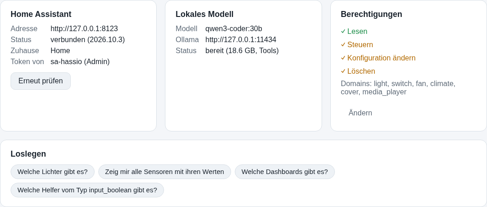

**Einstellungen**: Adresse und Token von Home Assistant (nach dem Speichern nie wieder angezeigt), das lokale
Modell, die Stufen mit ihren "ohne Freigabe"-Schaltern und die erlaubten Domains. Mit ▲ markierte Chips
(Rollläden/Abdeckungen, Automationen, Schlösser, Alarmanlage) haben Folgen für die Sicherheit oder das Gebäude und
sollten bewusst erlaubt werden.

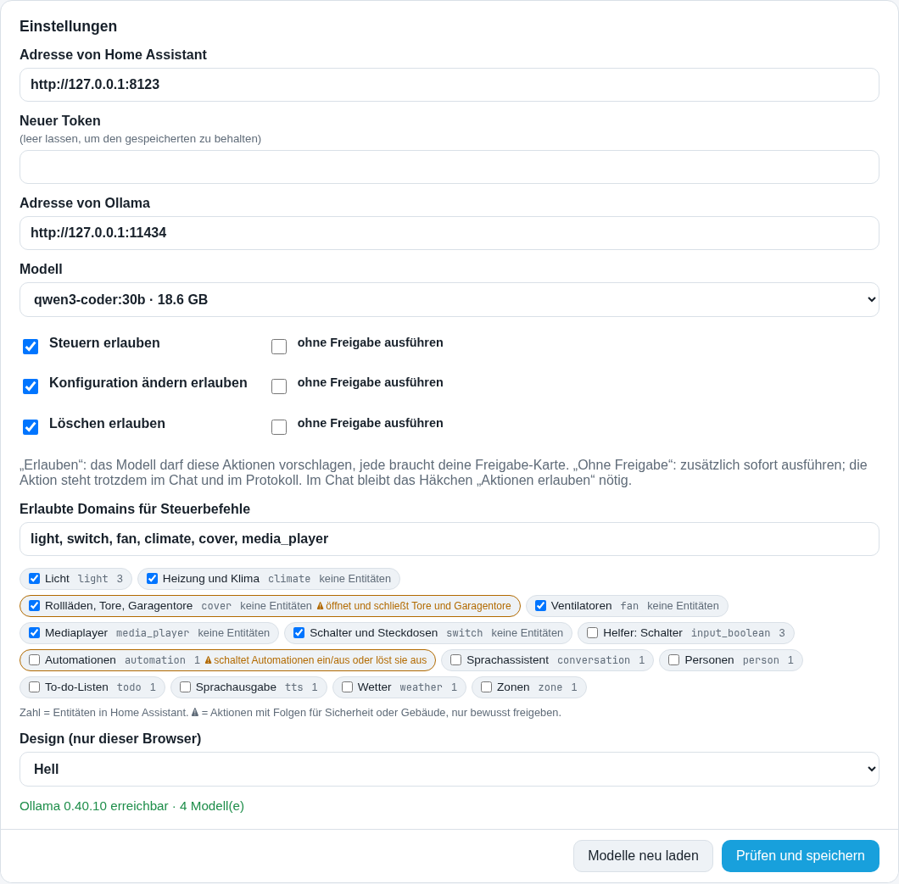

**Zugangsdaten**: Logins für Geräte und Dienste (z. B. ein Shelly-Passwort). Sie werden verschlüsselt auf diesem
Computer gespeichert und nie angezeigt; im Chat nennst du nur den Alias, das Modell sieht den Wert nie.

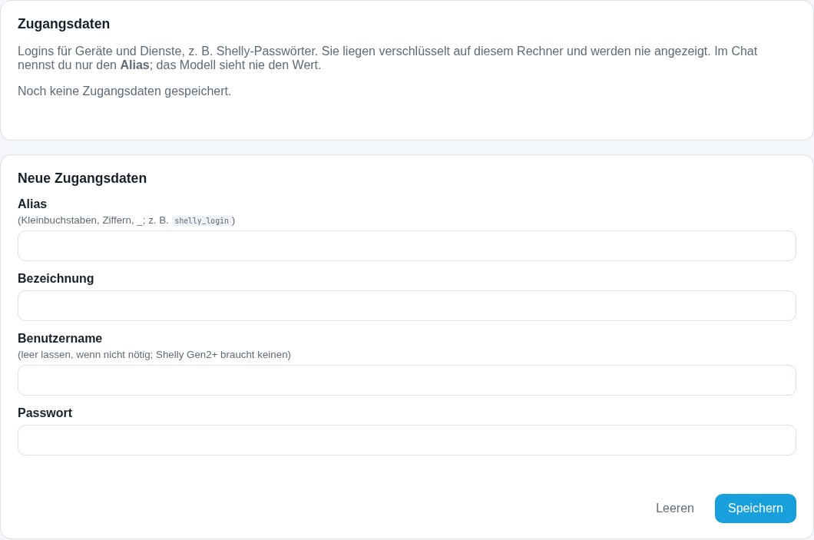

**MCP-Clients**: Tokens für externe KI-Clients, jeder mit eigener Stufe und optionaler Domain-Liste. Das Token
wird beim Anlegen einmal angezeigt.

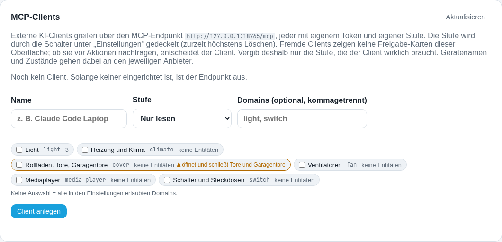

**Dateien**: Pläne und Skripte, die das Modell im Chat geschrieben hat, nur auf diesem Computer gespeichert (sie
landen nie in Home Assistant). **Protokoll**: ein Log jedes Aufrufs, das nur Metadaten enthält (Zeit, Werkzeug,
Route, Status, Dauer; keine Namen, Inhalte oder Tokens) und nach 30 Tagen gelöscht wird.

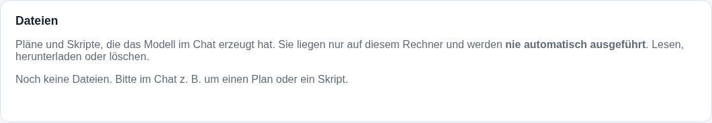

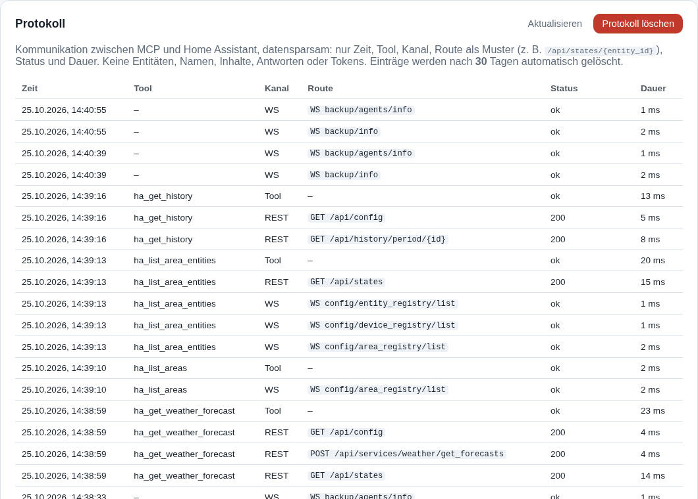

**Backups** und **Änderungen** werden in [Abschnitt 16](#16-backups) und [Abschnitt 19](#19-änderungsjournal-und-rückgängig) beschrieben.

## 1. Dinge finden und Zustände lesen

Frag nach allem in deinem Zuhause; Lesen verändert nie etwas.

| Werkzeug | Was es tut | Stufe |
|---|---|---|
| `ha_search_entities` | Findet Entitäten nach Name oder ID, optional nur einer Domain ("Stehlampe" → `light.stehlampe`). | Lesen |
| `ha_get_state` | Aktueller Zustand und Attribute einer Entität (an/aus, Helligkeit, Temperatur, ...). | Lesen |
| `ha_list_area_entities` | Alles in einem Bereich, nach Name oder Alias ("Wohnzimmer"), aufgeteilt in verfügbar und nicht verfügbar, dazu Gruppen. | Lesen |
| `ha_list_areas` | Alle Bereiche mit ID, Etage, Symbol und Aliasen. | Lesen |
| `ha_list_floors` | Alle Etagen mit Ebene. | Lesen |
| `ha_list_devices` | Geräte mit Hersteller, Modell und Bereich; Filter nach Bereich oder Text, oder Geräte ohne Bereich finden. | Lesen |
| `ha_list_services` | Welche Aktionen eine Domain anbietet (z. B. `light.turn_on`, `cover.open_cover`). | Lesen |
| `ha_list_entity_registry` | Registry-Einträge aller Entitäten, die von Integrationen verwaltet werden. | Lesen |
| `ha_get_entity_registry` | Die Einstellungen einer Entität: Name, Symbol, Bereich, Labels, Kategorien, Aliase für Sprachassistenten, ausgeblendet/deaktiviert. | Lesen |

**Beispiel**: *"Welche Lampen gibt es im Wohnzimmer und welche sind an?"* Das Modell fragt die Entitäten des
Bereichs ab und antwortet anhand der aktuellen Zustände:

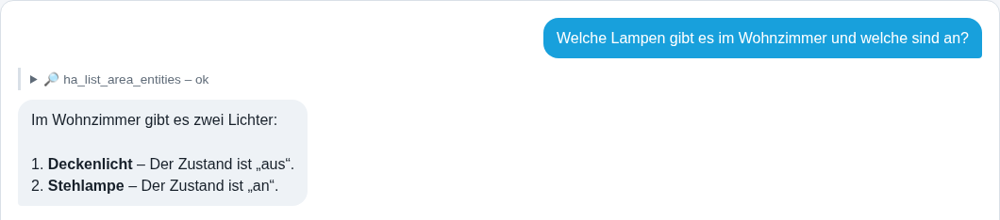

## 2. Geräte schalten, Szenen und Skripte starten

| Werkzeug | Was es tut | Stufe |
|---|---|---|
| `ha_call_service` | Führt eine Aktion auf einer Entität oder bis zu 20 Entitäten derselben Domain aus (z. B. alle Lampen eines Bereichs), **liest die Ziele danach zurück** und meldet pro Entität, ob der erwartete Zustand erreicht wurde. `return_response` liefert Daten von Aktionen, die antworten (z. B. `todo.get_items`). | Steuern |
| `ha_activate_scene` | Aktiviert eine Szene (`scene.turn_on`). Braucht `scene` in den erlaubten Domains. | Steuern |
| `ha_run_script` | Startet ein Skript (`script.turn_on`). Braucht `script` in den erlaubten Domains. | Steuern |
| `ha_fire_event` | Löst ein eigenes Ereignis aus (z. B. `doorbell_pressed`), auf das Automationen mit Ereignis-Auslöser reagieren. Ereignisse, die Home Assistant selbst sendet (`state_changed`, `homeassistant_start`, ...), werden abgelehnt. | Konfigurieren |

So ist es abgesichert: Nur erlaubte Domains können geschaltet werden, höchstens 20 Entitäten einer Domain pro
Aufruf, und nach jedem Aufruf wird zurückgelesen. Ein Ziel, das den erwarteten Zustand nicht erreicht hat, wird
deshalb als nicht bestätigt gemeldet statt als "erledigt". Das Chat-Modell ist zusätzlich angewiesen, die
einzelnen Entitäten eines Bereichs zu schalten (nicht eine Gruppe zusätzlich zu ihren Mitgliedern) und nicht
verfügbare Entitäten zu nennen, statt sie zu schalten.

**Beispiel**: *"Schalte die Stehlampe im Wohnzimmer aus"* (mit angehaktem *Aktionen erlauben*). Das Modell findet
die Lampe und bittet um Freigabe:

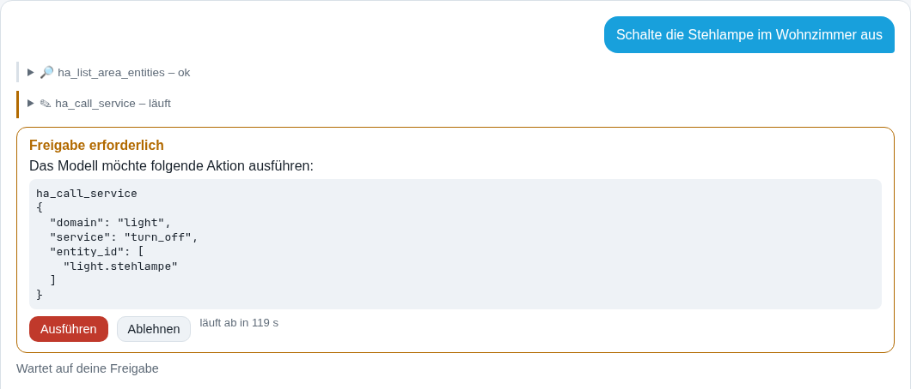

Nach *Ausführen* schaltet der MCP, liest die Lampe zurück und das Modell meldet das bestätigte Ergebnis:

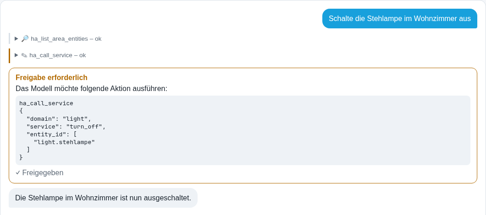

**Beispiel für eine Ablehnung**: *"Setze Milch auf die Einkaufsliste"*, während `todo` keine erlaubte Domain ist.
Auch nach der Freigabe lehnt der MCP ab und das Modell erklärt, was fehlt:

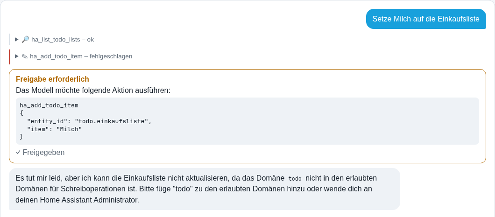

## 3. Automationen

| Werkzeug | Was es tut | Stufe |
|---|---|---|
| `ha_validate_automation` | Lässt Home Assistant Auslöser, Bedingungen und Aktionen prüfen, ohne zu speichern. | Lesen |
| `ha_get_automation` | Liest die Konfiguration einer Automation. | Lesen |
| `ha_save_automation` | Prüft, erstellt oder aktualisiert eine Automation und liest sie zurück. Im Änderungsjournal. | Konfigurieren |
| `ha_delete_automation` | Löscht eine Automation. Im Änderungsjournal: Rückgängig legt sie neu an. | Löschen |

**Beispiel**: *"Erstelle eine Automation, die bei Sonnenuntergang die Stehlampe einschaltet, wenn sie aus ist."*
Die Freigabekarte zeigt die vollständige Konfiguration, z. B.:

```json
{"alias": "Abendlicht", "triggers": [{"trigger": "sun", "event": "sunset"}],
 "conditions": [{"condition": "state", "entity_id": "input_boolean.demo_stehlampe", "state": "off"}],
 "actions": [{"action": "light.turn_on", "target": {"entity_id": "light.stehlampe"}}], "mode": "single"}
```

Warum eine Automation gelaufen ist oder nicht: siehe [Abschnitt 11](#11-fehlersuche-warum-ist-etwas-nicht-passiert).

## 4. Skripte und Szenen

| Werkzeug | Was es tut | Stufe |
|---|---|---|
| `ha_list_scripts` | Skripte mit ID, ob sie gerade laufen und wann sie zuletzt gelaufen sind. | Lesen |
| `ha_get_script` | Die gespeicherte Konfiguration eines Skripts. | Lesen |
| `ha_save_script` | Erstellt oder ersetzt ein Skript (HA prüft die Abfolge vorher). Im Änderungsjournal. | Konfigurieren |
| `ha_delete_script` | Löscht ein Skript. Im Änderungsjournal. | Löschen |
| `ha_list_scenes` | Szenen mit den Entitäten, die sie steuern. | Lesen |
| `ha_get_scene` | Die gespeicherten Zielzustände einer Szene. | Lesen |
| `ha_save_scene` | Erstellt oder ersetzt eine Szene, z. B. `{"name": "Abendlicht", "entities": {"light.stehlampe": {"state": "on", "brightness": 120}}}`. Im Änderungsjournal. | Konfigurieren |
| `ha_delete_scene` | Löscht eine Szene. Im Änderungsjournal. | Löschen |

Das Starten steht in [Abschnitt 2](#2-geräte-schalten-szenen-und-skripte-starten) (`ha_run_script`, `ha_activate_scene`).

**Beispiel**: *"Lege ein Skript 'Gute Nacht' an, das alle Lampen im Wohnzimmer ausschaltet."*

## 5. Dashboards, eigene Karten und Themes

| Werkzeug | Was es tut | Stufe |
|---|---|---|
| `ha_list_dashboards` | Dashboards mit URL-Pfad. | Lesen |
| `ha_get_dashboard` | Ansichten und Karten eines Dashboards. | Lesen |
| `ha_create_dashboard` | Erstellt ein neues Dashboard und prüft, ob es erscheint. Im Änderungsjournal. | Konfigurieren |
| `ha_save_dashboard` | Speichert Ansichten und Karten und liest sie zurück. Im Änderungsjournal. | Konfigurieren |
| `ha_update_dashboard` | Ändert Titel, Symbol oder die Anzeige in der Seitenleiste. Im Änderungsjournal. | Konfigurieren |
| `ha_delete_dashboard` | Löscht ein Dashboard. Im Änderungsjournal. | Löschen |
| `ha_list_dashboard_resources` | Dateien für eigene Karten (JavaScript/CSS), die das Frontend lädt. | Lesen |
| `ha_add_dashboard_resource` | Registriert eine Kartendatei, die von deinem eigenen Home Assistant ausgeliefert wird (`/local/...`, `/hacsfiles/...`). Externe URLs werden abgelehnt, weil Ressourcen im Browser jedes Benutzers laufen. Im Änderungsjournal. | Konfigurieren |
| `ha_delete_dashboard_resource` | Entfernt eine Ressource. Im Änderungsjournal. | Löschen |
| `ha_list_themes` | Installierte Themes und die aktuellen Standards. | Lesen |
| `ha_set_theme` | Legt das Standard-Theme für den hellen oder dunklen Modus fest. Im Änderungsjournal. | Konfigurieren |

**Beispiel**: *"Erstelle ein Dashboard 'Wohnzimmer' mit einer Karte für jede Lampe im Wohnzimmer."*

## 6. Helfer

Helfer sind die Bausteine unter *Einstellungen → Geräte & Dienste → Helfer*.

| Werkzeug | Was es tut | Stufe |
|---|---|---|
| `ha_list_helpers` | Helfer eines Typs: Schalter, Zahl, Auswahl, Text, Datum/Uhrzeit, Taste, Zähler, Timer, Zeitplan. | Lesen |
| `ha_list_helper_types` | Welche Helfertypen es gibt und wie man sie anlegt, einschließlich Template-, Gruppen-, Verbrauchszähler-, Ableitungs-, Schwellenwert- und Tageszeit-Helfern (werden über einen geführten Ablauf eingerichtet, siehe [Abschnitt 9](#9-integrationen)). | Lesen |
| `ha_create_helper` | Legt einen einfachen Helfer an (z. B. einen Timer `{"name": "Tee", "duration": "00:04:00"}` oder einen Zeitplan). Im Änderungsjournal. | Konfigurieren |
| `ha_update_helper` | Ändert einen Helfer und liest ihn zurück. Im Änderungsjournal. | Konfigurieren |
| `ha_delete_helper` | Löscht einen Helfer. Im Änderungsjournal. | Löschen |

**Beispiel**: *"Lege einen Template-Sensor an, der zählt, wie viele Lampen an sind."* Das Modell startet den
Template-Ablauf mit `ha_start_integration_setup` und füllt das Formular Schritt für Schritt aus, jeden Schritt mit
einer eigenen Karte.

## 7. Bereiche, Etagen, Geräte und Entitäten

| Werkzeug | Was es tut | Stufe |
|---|---|---|
| `ha_create_area` | Legt einen Bereich an. Im Änderungsjournal. | Konfigurieren |
| `ha_update_area` | Benennt einen Bereich um oder ändert Etage, Symbol oder Aliase. Im Änderungsjournal. | Konfigurieren |
| `ha_delete_area` | Löscht einen Bereich; seine Geräte bleiben erhalten und verlieren nur den Bereich. Im Änderungsjournal. | Löschen |
| `ha_create_floor` | Legt eine Etage mit Ebene an. Im Änderungsjournal. | Konfigurieren |
| `ha_update_floor` | Ändert eine Etage. Im Änderungsjournal. | Konfigurieren |
| `ha_delete_floor` | Löscht eine Etage; ihre Bereiche bleiben erhalten. Im Änderungsjournal. | Löschen |
| `ha_update_device` | Verschiebt ein Gerät in einen Bereich, benennt es um oder deaktiviert es, setzt Labels. Im Änderungsjournal. Geräte zu entfernen wird bewusst nicht angeboten. | Konfigurieren |
| `ha_update_entity_registry` | Ändert Name, Symbol, Bereich, Labels, Kategorien, Aliase für Sprachassistenten und ausgeblendet/deaktiviert einer Entität. Im Änderungsjournal. | Konfigurieren |
| `ha_rename_entity` | Ändert eine Entitäts-ID (`light.x` → `light.y`); HA behält den Verlauf. Listet die Automationen, Skripte und Dashboards auf, die noch die alte ID verwenden. Im Änderungsjournal. | Konfigurieren |

**Beispiel**: *"Verschiebe das Arbeitslicht in die Küche und gib ihm den Alias 'Küchenlicht'."*

## 8. Labels, Kategorien und Zonen

| Werkzeug | Was es tut | Stufe |
|---|---|---|
| `ha_list_labels` | Labels mit Farbe, Symbol und wie viele Entitäten, Geräte und Bereiche sie tragen. | Lesen |
| `ha_get_label` | Ein Label mit allem, was es trägt. | Lesen |
| `ha_create_label` | Legt ein Label an (HA-Theme-Farbe oder `#rrggbb`, `mdi:`-Symbol). Im Änderungsjournal. | Konfigurieren |
| `ha_update_label` | Ändert ein Label. Im Änderungsjournal. | Konfigurieren |
| `ha_delete_label` | Löscht ein Label überall; Rückgängig hängt es wieder an dieselben Elemente. | Löschen |
| `ha_list_categories` | Kategorien der Automations-, Skript-, Szenen- oder Helferliste. | Lesen |
| `ha_create_category` | Legt eine Kategorie an. Im Änderungsjournal. | Konfigurieren |
| `ha_update_category` | Benennt eine Kategorie um oder ändert ihr Symbol. Im Änderungsjournal. | Konfigurieren |
| `ha_delete_category` | Löscht eine Kategorie; Rückgängig ordnet die Elemente wieder ein. | Löschen |
| `ha_list_zones` | Zonen mit Position, Radius, Personen darin und ob sie bearbeitet werden können (`zone.home` und YAML-Zonen nicht). | Lesen |
| `ha_create_zone` | Legt eine Zone an (z. B. Arbeit) mit Radius in Metern; passive Zonen dienen nur Automationen. Im Änderungsjournal. | Konfigurieren |
| `ha_update_zone` | Verschiebt eine Zone, ändert ihre Größe oder benennt sie um. Im Änderungsjournal. | Konfigurieren |
| `ha_delete_zone` | Löscht eine Zone; Rückgängig legt sie neu an. | Löschen |

**Beispiel**: *"Lege ein Label 'Doku-Demo' in Blau an."* Die Karte zeigt Name und Farbe:

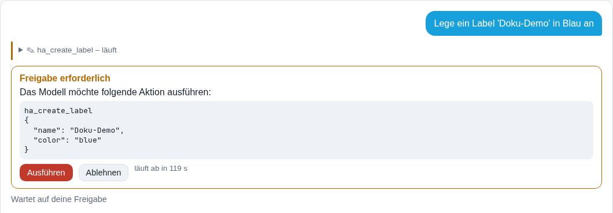

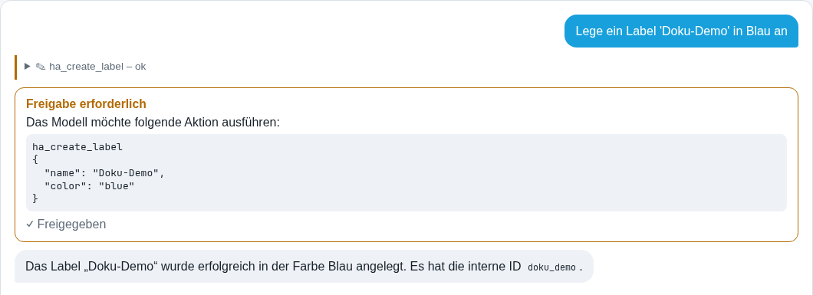

## 9. Integrationen

Integrationen einrichten, konfigurieren und pflegen, so wie es die HA-Oberfläche macht: Schritt für Schritt.

| Werkzeug | Was es tut | Stufe |
|---|---|---|
| `ha_list_integrations` | Eingerichtete Integrationen mit Zustand (geladen, fehlgeschlagen, ...). | Lesen |
| `ha_list_integration_types` | Integrationen, die sich über die Oberfläche hinzufügen lassen, gefiltert nach Name (z. B. "shelly"). | Lesen |
| `ha_list_discovered` | Geräte, die Home Assistant selbst entdeckt hat und die auf Bestätigung warten. Dein Netzwerk wird dabei nicht durchsucht. | Lesen |
| `ha_list_credentials` | Namen deiner gespeicherten Logins und ihre Felder (nie die Werte). | Lesen |
| `ha_start_integration_setup` | Startet das Hinzufügen einer Integration oder eines geführten Helfers; liefert das erste Formular oder Menü. | Konfigurieren |
| `ha_integration_setup_step` | Schickt einen Formularschritt ab. Felder für Passwort, Token, API-Schlüssel und PIN nehmen nur einen Verweis auf *Zugangsdaten* an, nie einen Klartextwert. Eine neu angelegte Integration kommt ins Änderungsjournal (Rückgängig entfernt sie). | Konfigurieren |
| `ha_abort_integration_setup` | Bricht eine laufende Einrichtung ab. | Konfigurieren |
| `ha_start_integration_options` | Öffnet die Optionen einer Integration mit ihren aktuellen Werten. | Konfigurieren |
| `ha_integration_options_step` | Schickt einen Optionsschritt ab. | Konfigurieren |
| `ha_abort_integration_options` | Schließt die Optionen ohne zu speichern. | Konfigurieren |
| `ha_start_integration_reconfigure` | Ändert die Verbindung (z. B. eine neue IP-Adresse). | Konfigurieren |
| `ha_update_integration` | Benennt eine Integration um oder ändert die Optionen für Abfragen / neue Entitäten. Im Änderungsjournal. | Konfigurieren |
| `ha_set_integration_disabled` | Deaktiviert eine Integration oder aktiviert sie wieder. Im Änderungsjournal. | Konfigurieren |
| `ha_reload_integration` | Lädt eine einzelne Integration neu. | Konfigurieren |
| `ha_delete_integration` | Entfernt eine Integration samt ihren Geräten. | Löschen |

**Beispiel**: Speichere zuerst den Shelly-Login unter *Zugangsdaten* mit dem Alias `shelly_login` und frag dann
*"Füge den Shelly mit der IP 192.168.1.50 hinzu, Login shelly_login."* Das Modell füllt das Passwortfeld mit
`{"$credential": "shelly_login", "field": "password"}`; der MCP setzt den echten Wert ein, das Modell sieht ihn nie.

## 10. Konfigurationsdateien (YAML)

Für alles, was die Oberfläche nicht abbilden kann: `configuration.yaml`, Packages, Template-Sensoren, Custom
Components. Unter HA OS / Supervised muss das offizielle Add-on **File editor** installiert und gestartet sein
(sonst ist nichts einzurichten); bei einer Container-Installation setzt der Betreiber `HA_CONFIG_DIR`.

| Werkzeug | Was es tut | Stufe |
|---|---|---|
| `ha_list_config_files` | Zeigt einen Ordner des Konfigurationsverzeichnisses mit Größen und welche Dateien gelesen werden können. | Lesen |
| `ha_read_config_file` | Liest eine Textdatei. Passwörter darin erscheinen als `__REDACTED_1__`. | Lesen |
| `ha_edit_config_file` | Ersetzt ein genau angegebenes Textstück. | Konfigurieren |
| `ha_write_config_file` | Legt eine Datei an oder ersetzt ihren gesamten Inhalt (z. B. ein neues Package). | Konfigurieren |
| `ha_delete_config_file` | Löscht eine Datei. | Löschen |

So ist es abgesichert:

- **Nie zugänglich**, nicht einmal zum Lesen: `secrets.yaml`, `.storage`, Datenbanken, Logs, Schlüssel- und
  Zugangsdaten-Dateien.
- **Passwörter in Dateien** werden durch Platzhalter ersetzt, bevor das Modell sie sieht, und unverändert
  zurückgeschrieben. Neue Passwörter gehören in die `secrets.yaml` (trägst du selbst ein) und werden mit
  `!secret name` angesprochen.
- **Vor dem Schreiben** wird die YAML-Syntax geprüft; kaputtes YAML wird nie gespeichert.
- **Nach dem Schreiben** prüft Home Assistant die Konfiguration. Ein neuer Fehler oder eine neue Warnung (z. B.
  "Setup of package failed") stellt automatisch die vorherige Datei wieder her, und das Werkzeug sagt, warum.
- Jeder Schreibvorgang kommt ins Änderungsjournal und lässt sich rückgängig machen. Eine Änderung wirkt erst nach
  `ha_reload` oder `ha_restart`.

**Beispiel**: *"Welche Dateien bindet die configuration.yaml ein?"*

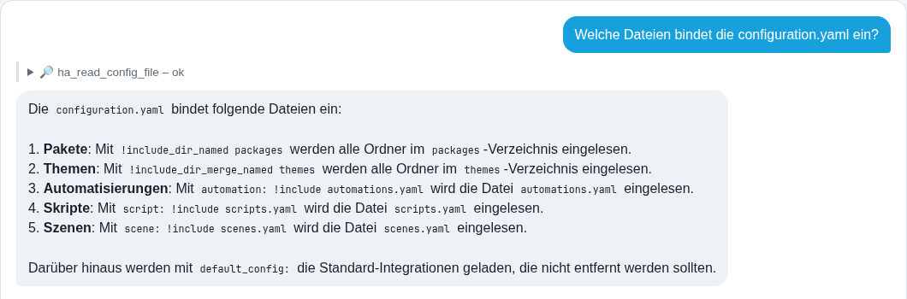

Eine typische Änderung, die das Modell schickt (auf der Freigabekarte angezeigt):

```json
{"path": "configuration.yaml", "old_text": "default_config:\n",
 "new_text": "default_config:\n\nhomeassistant:\n  packages: !include_dir_named packages\n"}
```

## 11. Fehlersuche: Warum ist etwas (nicht) passiert?

| Werkzeug | Was es tut | Stufe |
|---|---|---|
| `ha_list_traces` | Die letzten Durchläufe von Automationen oder Skripten mit dem Ergebnis in einfachen Worten (`outcome`: abgeschlossen, durch eine Bedingung gestoppt, Fehler, ...) und was sie ausgelöst hat. | Lesen |
| `ha_get_trace` | Die Schritte eines Durchlaufs mit Fehlern, Ergebnissen und geänderten Variablen. | Lesen |
| `ha_get_error_log` | Das Fehler- und Warnungslog von Home Assistant, neueste zuerst, mit Wiederholungszahl; Filter nach Stufe oder Text. | Lesen |
| `ha_get_logbook` | Was passiert ist und was es ausgelöst hat (Zustandsänderungen, Auslöser, Aktionen). | Lesen |
| `ha_get_history` | Zustandsverlauf von bis zu 10 Entitäten, in deiner Zeitzone. | Lesen |
| `ha_get_statistics` | Langzeitstatistiken (Energie, Temperaturen) pro Stunde, Tag, Woche oder Monat. | Lesen |
| `ha_list_statistic_ids` | Welche Entitäten Langzeitstatistiken haben. | Lesen |
| `ha_list_repairs` | Offene Reparaturmeldungen (*Einstellungen → Reparaturen*). | Lesen |
| `ha_get_system_health` | Systemzustand pro Komponente (Datenbank, Installationsart, ...). | Lesen |
| `ha_render_template` | Wertet ein Jinja-Template mit dem aktuellen Zustand aus, z. B. `{{ states.light \| selectattr('state','eq','on') \| list \| count }}`. | Lesen |
| `ha_test_condition` | Testet eine Bedingung jetzt sofort, ohne etwas zu speichern. | Lesen |

**Beispiel**: *"Wann und warum ist die Automation Abendlicht zuletzt gelaufen?"*

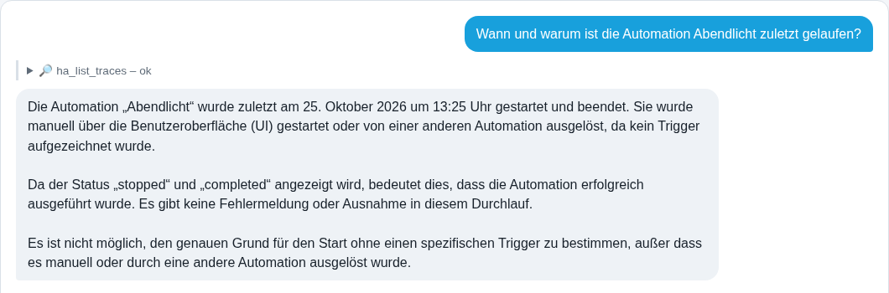

**Beispiel**: *"Wann war die Stehlampe im Wohnzimmer heute an? Schau im Verlauf nach."*

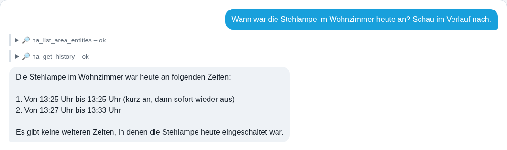

## 12. Überblick und "Wo wird das verwendet?"

| Werkzeug | Was es tut | Stufe |
|---|---|---|
| `ha_get_overview` | Ein kompaktes Bild deiner Installation: Version, Entitäten pro Domain (nicht verfügbar, an), Bereiche, Geräte, Automationen, Dashboards, fehlerhafte Integrationen. | Lesen |
| `ha_find_usages` | Wo eine Entität oder Aktion verwendet wird: Automationen, Skripte, Szenen, Gruppen und Dashboards, mit der Stelle in der Konfiguration. Nutze es, bevor du etwas umbenennst oder entfernst. | Lesen |

**Beispiel**: *"Wo wird die Stehlampe verwendet?"*

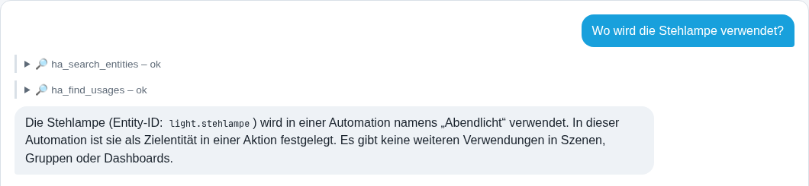

**Beispiel**: *"Gib mir einen kurzen Überblick über mein Home Assistant."*

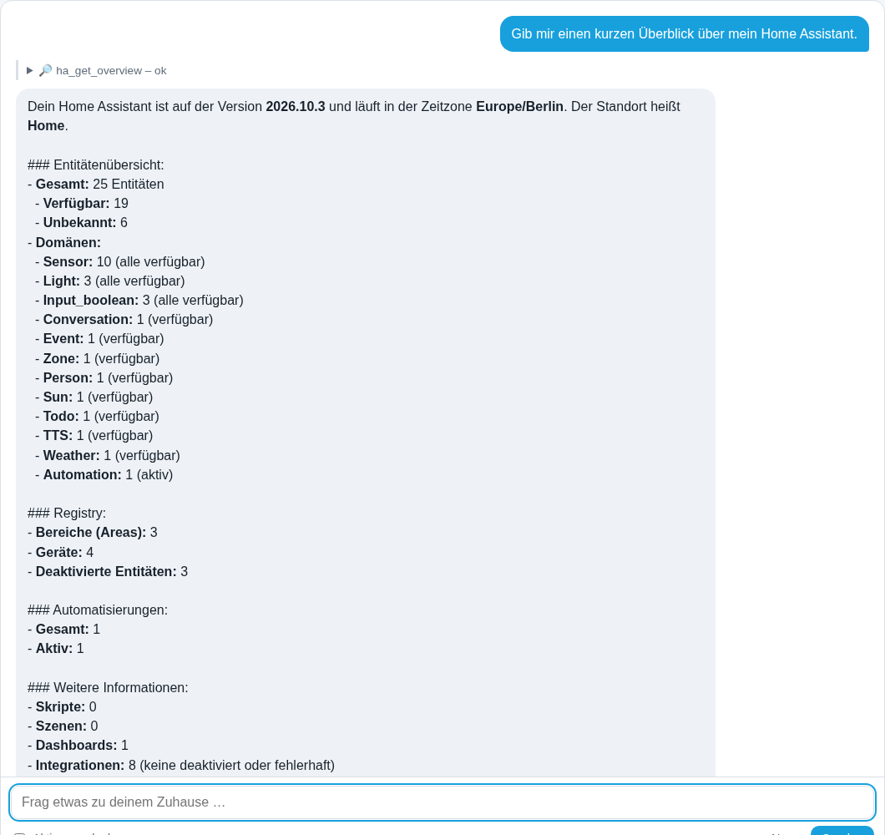

## 13. Kalender und To-do-Listen

| Werkzeug | Was es tut | Stufe |
|---|---|---|
| `ha_list_calendars` | Kalender-Entitäten. | Lesen |
| `ha_get_calendar_events` | Termine eines oder aller Kalender für 1-31 Tage. | Lesen |
| `ha_create_calendar_event` | Fügt einen Termin hinzu (mit Uhrzeit oder ganztägig). Braucht die Erlaubnis für `calendar`. | Steuern |
| `ha_update_calendar_event` | Ändert einen Termin oder ein einzelnes Vorkommen einer Serie. | Steuern |
| `ha_delete_calendar_event` | Löscht einen Termin. Lässt sich nicht rückgängig machen. | Löschen |
| `ha_list_todo_lists` | To-do-Listen (z. B. die Einkaufsliste) mit offenen Einträgen. | Lesen |
| `ha_get_todo_items` | Einträge einer Liste (offen, erledigt oder alle). | Lesen |
| `ha_add_todo_item` | Fügt einen Eintrag hinzu. Braucht die Erlaubnis für `todo`; unbekannte Listen werden gemeldet. | Steuern |
| `ha_update_todo_item` | Hakt einen Eintrag ab, öffnet ihn wieder, benennt ihn um oder setzt ein Fälligkeitsdatum. | Steuern |
| `ha_remove_todo_items` | Entfernt Einträge. Lässt sich nicht rückgängig machen; meistens willst du eher abhaken. | Löschen |

Kalendertermine und Listeneinträge sind deine Daten, keine Konfiguration, deshalb stehen sie nicht im
Änderungsjournal.

**Beispiel**: *"Was steht morgen im Kalender?"*, *"Hake Milch auf der Einkaufsliste ab."*

## 14. Wetter

| Werkzeug | Was es tut | Stufe |
|---|---|---|
| `ha_get_weather_forecast` | Aktuelles Wetter und Vorhersage (täglich, stündlich, zweimal täglich) in deiner Zeitzone; jeder Eintrag ist mit "heute", "morgen" oder dem Wochentag beschriftet, und `day` wählt einen bestimmten Tag. | Lesen |

**Beispiel**: *"Wie wird das Wetter morgen?"*

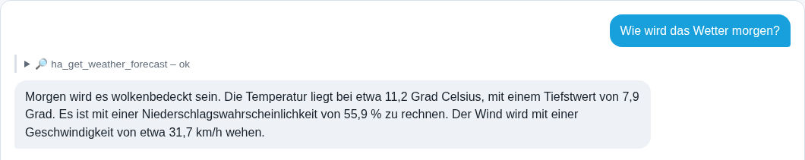

## 15. Updates, Konfigurationsprüfung, Neu laden und Neustart

| Werkzeug | Was es tut | Stufe |
|---|---|---|
| `ha_list_updates` | Ausstehende Updates (Home Assistant, Add-ons, Firmware, Integrationen) mit Versionen. | Lesen |
| `ha_get_release_notes` | Versionshinweise eines Updates. | Lesen |
| `ha_check_config` | Prüft die Konfigurationsdateien (gültig oder Fehler und Warnungen); ändert nichts. | Lesen |
| `ha_reload` | Lädt die Konfiguration ohne Neustart neu: alles, die Kernkonfiguration oder einen Teil wie Automationen oder Templates. | Konfigurieren |
| `ha_skip_update` | Überspringt eine angebotene Version (oder bietet sie wieder an). | Konfigurieren |
| `ha_install_update` | Installiert ein Update, auf Wunsch mit vorherigem Backup. Weitreichend, deshalb auf der Stufe Löschen. | Löschen |
| `ha_restart` | Startet Home Assistant neu, nur nach erfolgreicher Konfigurationsprüfung. Unterbricht Automationen für etwa eine Minute. | Löschen |

**Beispiel**: *"Gibt es Updates?"*, *"Prüfe die Konfiguration und lade danach die Automationen neu."*

## 16. Backups

| Werkzeug | Was es tut | Stufe |
|---|---|---|
| `ha_list_backups` | Backups, neueste zuerst, mit Größe und Speicherort. | Lesen |
| `ha_create_backup` | Erstellt ein vollständiges Backup und wartet, bis es in der Liste erscheint; ein Verschlüsselungspasswort nur als Verweis auf *Zugangsdaten*. | Konfigurieren |
| `ha_delete_backup` | Löscht ein Backup. | Löschen |

Das Wiederherstellen eines Backups ist geplant (mit einem frischen Backup direkt davor und einer klaren
Freigabekarte), aber noch nicht verfügbar. Die Seite *Backups* in der Weboberfläche listet die Backups auf und
kann eines erstellen, bevor du etwas änderst:

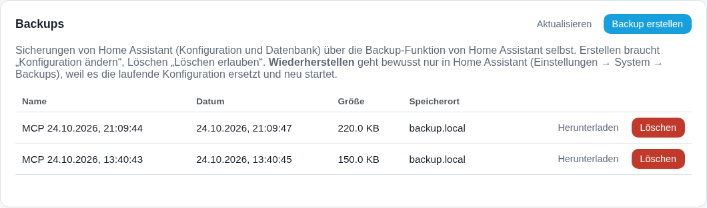

## 17. Blueprints

| Werkzeug | Was es tut | Stufe |
|---|---|---|
| `ha_list_blueprints` | Blueprints für Automationen, Skripte oder Templates mit ihren Eingaben und ihrer Quelle. | Lesen |
| `ha_preview_blueprint` | Lässt Home Assistant einen Blueprint von einer https-URL holen und zeigt Name, Eingaben und Probleme, ohne zu speichern. | Konfigurieren |
| `ha_save_blueprint` | Importiert einen Blueprint; vorhandene werden nie überschrieben. Im Änderungsjournal: Rückgängig löscht ihn. | Konfigurieren |
| `ha_delete_blueprint` | Löscht einen Blueprint (HA lehnt ab, solange er verwendet wird); Rückgängig importiert ihn erneut aus seiner Quelle. | Löschen |

**Beispiel**: *"Importiere den Bewegungsmelder-Blueprint von <URL> und erstelle damit eine Automation für den
Flur."* Die Automation verwendet dann `{"use_blueprint": {"path": "...", "input": {...}}}`.

## 18. Add-ons, System, HACS, Zigbee und Thread

Alles nur lesend. Ohne Supervisor, HACS oder ZHA sagen die Werkzeuge das, statt mit einem Fehler abzubrechen. Es
werden keine Geräteadressen, IP-Adressen, Hostnamen oder Netzwerkschlüssel zurückgegeben.

| Werkzeug | Was es tut | Stufe |
|---|---|---|
| `ha_list_addons` | Installierte Add-ons mit Zustand, Version und ausstehendem Update. | Lesen |
| `ha_get_system_info` | Versionen von Core, Supervisor und OS, Zustand des Supervisors, Board und Speicherplatzbelegung. | Lesen |
| `ha_list_hacs_repositories` | Was über HACS installiert ist, mit installierter und verfügbarer Version. | Lesen |
| `ha_list_zigbee_devices` | Zigbee-Geräte mit Verfügbarkeit, Signalqualität und letztem Kontakt; `problems_only` zeigt nur nicht verfügbare oder schwache Geräte. | Lesen |
| `ha_list_thread_networks` | Thread-Netzwerke (Name, Kanal, bevorzugt). | Lesen |

**Beispiel**: *"Welche Zigbee-Geräte haben schlechten Empfang oder sind offline?"*

## 19. Änderungsjournal und Rückgängig

Vor jeder Konfigurationsänderung über den MCP wird der vorherige Zustand 30 Tage lang auf diesem Computer
gespeichert. Die Seite *Änderungen* listet sie mit einer Schaltfläche *Rückgängig* auf; das Modell kann dasselbe.

| Werkzeug | Was es tut | Stufe |
|---|---|---|
| `ha_list_changes` | Die letzten Änderungen: was, welches Ziel und ob sie rückgängig gemacht wurden. | Lesen |
| `ha_get_change` | Eine Änderung mit dem gespeicherten vorherigen Zustand (Passwörter in Dateien bleiben maskiert). | Lesen |
| `ha_undo_change` | Schreibt den vorherigen Zustand zurück (entfernt, was neu angelegt wurde, und legt neu an, was gelöscht wurde). Auch das Rückgängigmachen kommt ins Änderungsjournal und lässt sich selbst wieder rückgängig machen; gibt es neuere Änderungen am selben Element, lehnt es ab, außer du bestehst darauf. | Konfigurieren (Löschen, wenn dabei etwas entfernt wird) |

Nicht im Änderungsjournal: Geräte schalten und Ereignisse auslösen, Kalender- und To-do-Einträge, das Entfernen
einer Integration, Options-Dialoge, Updates, Neustarts und Backups. Eine neu eingerichtete Integration kommt ins
Änderungsjournal (Rückgängig entfernt sie).


## 20. Direkter REST-Zugriff (für Fortgeschrittene)

Für den seltenen Fall, dass es kein eigenes Werkzeug gibt. Erlaubt sind nur dokumentierte Routen der REST-API von
Home Assistant, jede mit ihrer Berechtigungsklasse.

| Werkzeug | Was es tut | Stufe |
|---|---|---|
| `ha_rest_catalog` | Listet die erlaubten Routen auf und welche Stufe jede braucht. | Lesen |
| `ha_rest_query` | Ruft eine dokumentierte Leseroute auf (oder die sicheren Routen für Templates und Konfigurationsprüfung). | Lesen |
| `ha_rest_write` | Ruft eine dokumentierte Schreibroute auf. | Konfigurieren |
| `ha_rest_delete` | Ruft eine dokumentierte Löschroute auf. | Löschen |

Nimm lieber die eigenen Werkzeuge weiter oben: Sie prüfen die Eingaben, lesen die Ergebnisse zurück und führen das
Änderungsjournal.
