# Feature guide: everything ha-safe-mcp can do

**English** · [Deutsch](FEATURES.de.md)

This guide explains every function of ha-safe-mcp in plain words: what it does, how it is protected, and how
you use it. The examples come from the web UI chat with a local model (Ollama, `qwen3-coder:30b`) on a small
demo home with three lights (Stehlampe and Deckenlicht in the Wohnzimmer, Arbeitslicht in the Küche) and the
automation "Abendlicht". The screenshots show the English web UI; the demo home keeps its German device and room
names, so you also see how the model maps English questions to them.

The screenshots are reproducible: `scripts/docs_demo_home.py` builds the demo home on a test instance and
`scripts/doc_screenshots.py --lang en` takes the pictures (`--lang de` for the German guide). For every tool's exact parameters see the generated
[tool reference](TOOLS.md). Setup and connecting clients
are in the [user guide](USER_GUIDE.md).

**Contents**

- [How to read this guide: levels, approval cards, undo](#how-to-read-this-guide-levels-approval-cards-undo)
- [The web UI at a glance](#the-web-ui-at-a-glance)
- [1. Find things and read states](#1-find-things-and-read-states)
- [2. Switch devices, run scenes and scripts](#2-switch-devices-run-scenes-and-scripts)
- [3. Automations](#3-automations)
- [4. Scripts and scenes](#4-scripts-and-scenes)
- [5. Dashboards, custom cards and themes](#5-dashboards-custom-cards-and-themes)
- [6. Helpers](#6-helpers)
- [7. Rooms, floors, devices and entities](#7-rooms-floors-devices-and-entities)
- [8. Labels, categories and zones](#8-labels-categories-and-zones)
- [9. Integrations](#9-integrations)
- [10. Configuration files (YAML)](#10-configuration-files-yaml)
- [11. Debugging: why did something (not) happen?](#11-debugging-why-did-something-not-happen)
- [12. Overview and "where is this used?"](#12-overview-and-where-is-this-used)
- [13. Calendars and to-do lists](#13-calendars-and-to-do-lists)
- [14. Weather](#14-weather)
- [15. Updates, configuration check, reload and restart](#15-updates-configuration-check-reload-and-restart)
- [16. Backups](#16-backups)
- [17. Blueprints](#17-blueprints)
- [18. Add-ons, system, HACS, Zigbee and Thread](#18-add-ons-system-hacs-zigbee-and-thread)
- [19. Energy: plugs, solar, battery storage](#19-energy-plugs-solar-battery-storage)
- [20. Voice assistants (Assist)](#20-voice-assistants-assist)
- [21. Change journal and undo](#21-change-journal-and-undo)
- [22. Direct REST access (advanced)](#22-direct-rest-access-advanced)

## How to read this guide: levels, approval cards, undo

Every tool belongs to one of four **levels**. The server only offers the levels you switched on under
*Einstellungen*; remote clients can be limited further per client (*MCP-Clients*).

| Level | Web UI name | What it allows | Examples |
|---|---|---|---|
| **Read** | Read only | Look at anything; nothing changes | states, history, logs, files |
| **Control** | Control | Use devices: switch, run, add items | turn on a light, run a script, add to the shopping list |
| **Configure** | Change configuration | Change how Home Assistant is set up | automations, dashboards, rooms, YAML files |
| **Delete** | Delete | Remove things and far-reaching actions | delete an automation, install an update, restart |

What protects you in the web UI chat:

- **"Allow actions"** must be ticked in the chat, otherwise the model may only read.
- **Approval card**: before every action the chat shows exactly what the model wants to run. Nothing happens
  until you press *Run*. A level marked "run without approval" in the settings skips the card; the
  action is still shown in the chat and logged.
- **Allowed domains**: *Control* only works for the device types you allowed (e.g. `light`, `switch`). Anything
  else is refused even after approval (see [example](#2-switch-devices-run-scenes-and-scripts)).
- **Change journal**: before any configuration change the previous state is saved for 30 days; *Undo*
  restores it ([section 19](#19-change-journal-and-undo)).
- **No passwords for the model**: logins are stored as *Credentials* and only referenced by name.
- Remote clients (Claude, ChatGPT, Codex) have no approval cards in this UI; whether they ask before acting is
  up to the client. Give them only the level they need.

## The web UI at a glance

**Overview** shows the connection to Home Assistant, the local model and which levels are switched on.

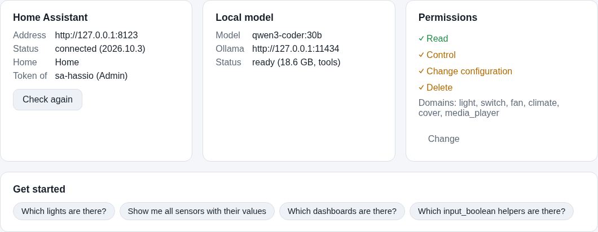

**Settings**: Home Assistant address and token (never shown again after saving), the local model, the
levels with their "run without approval" switches and the allowed domains. Chips marked ▲ (covers, automations, locks,
alarm) have consequences for safety or the building and should be allowed consciously.

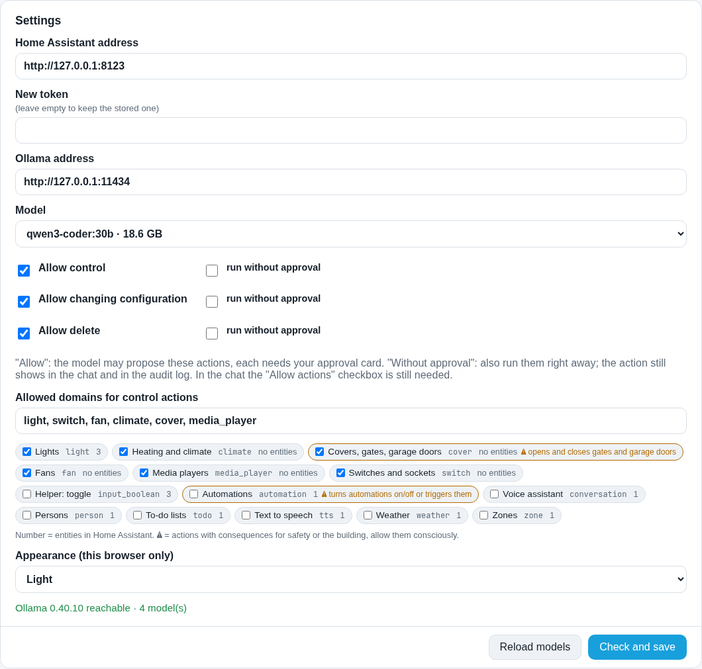

**Credentials**: logins for devices and services (e.g. a Shelly password). They are stored encrypted on this
computer and never shown; in the chat you only name the alias, the model never sees the value.

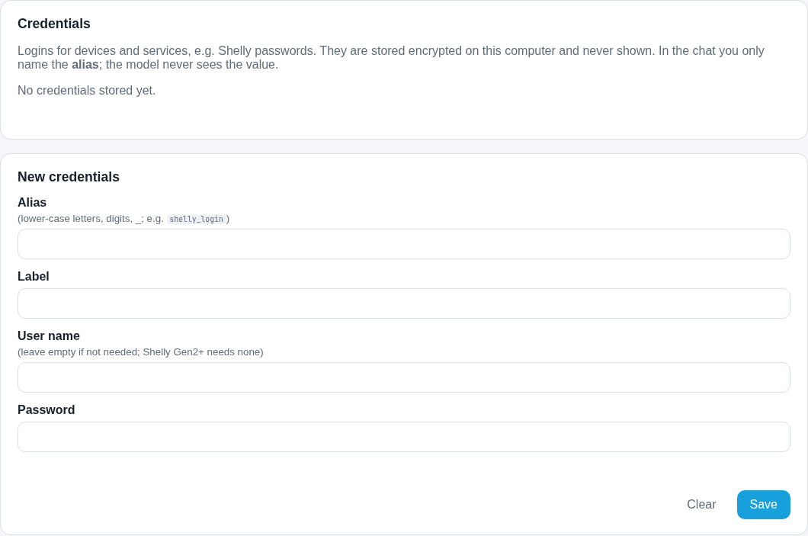

**MCP clients**: tokens for external AI clients, each with its own level and optional domain list. The token is
shown once when created.

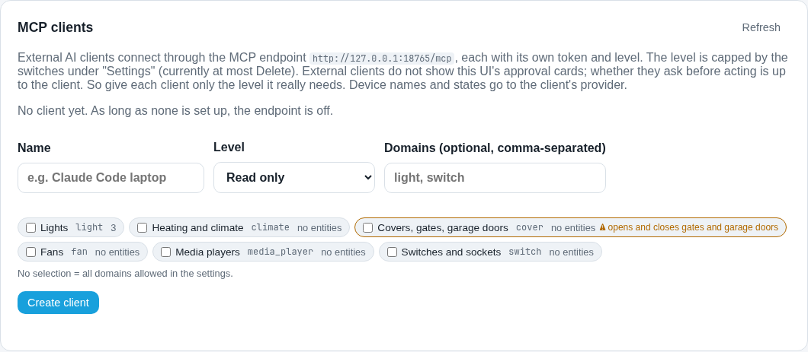

**Energy**: usage per device and source for today, yesterday, 7 or 30 days, the problems Home Assistant reports
for the energy dashboard, and energy sensors that are not in it yet, with *Add* and *Remove* buttons (journaled;
see [section 19](#19-energy-plugs-solar-battery-storage)).

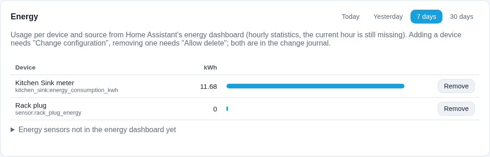

**Files**: plans and scripts the model wrote in the chat, stored on this computer only (they never reach Home
Assistant). **Audit log**: a metadata-only log of every call (time, tool, route, status, duration; no names,
contents or tokens), deleted after 30 days.

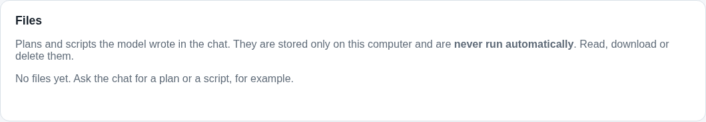

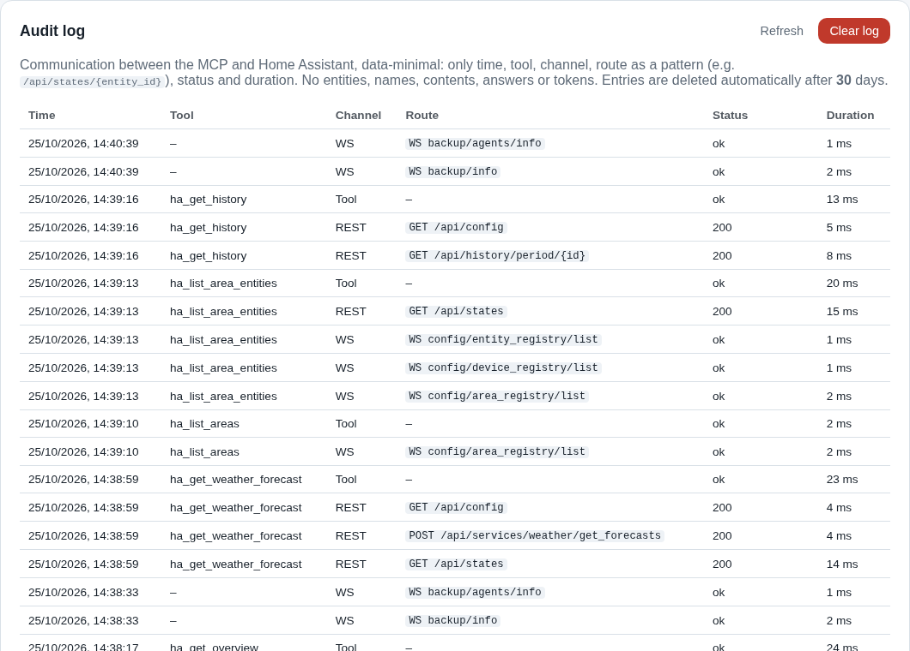

**Backups** and **Änderungen** are described in [section 16](#16-backups) and [section 19](#19-change-journal-and-undo).

## 1. Find things and read states

Ask about anything in your home; reading never changes anything.

| Tool | What it does | Level |
|---|---|---|
| `ha_search_entities` | Finds entities by name or ID, optionally of one domain ("Stehlampe" → `light.stehlampe`). | Read |
| `ha_get_state` | Current state and attributes of one entity (on/off, brightness, temperature, ...). | Read |
| `ha_list_area_entities` | Everything in one room, by name or alias ("Wohnzimmer"), split into available and unavailable, plus groups. | Read |
| `ha_list_areas` | All rooms with ID, floor, icon and aliases. | Read |
| `ha_list_floors` | All floors with level. | Read |
| `ha_list_devices` | Devices with manufacturer, model and room; filter by room or text, or find devices without a room. | Read |
| `ha_list_services` | Which actions a domain offers (e.g. `light.turn_on`, `cover.open_cover`). | Read |
| `ha_list_entity_registry` | Registry entries of all integration-managed entities. | Read |
| `ha_get_entity_registry` | One entity's settings: name, icon, room, labels, categories, voice-assistant aliases, hidden/disabled. | Read |

**Example**: *"Which lamps are in the living room (Wohnzimmer) and which are on?"* The model asks for the room's
entities and answers from the live states:

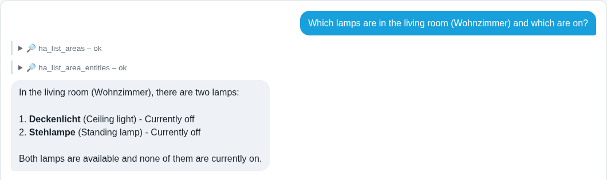

## 2. Switch devices, run scenes and scripts

| Tool | What it does | Level |
|---|---|---|
| `ha_call_service` | Runs an action on one entity or up to 20 of the same domain (e.g. all lights of a room), then **reads the targets back** and reports per entity whether the expected state was reached. `return_response` returns data from actions that answer (e.g. `todo.get_items`). | Control |
| `ha_activate_scene` | Activates a scene (`scene.turn_on`). Needs `scene` in the allowed domains. | Control |
| `ha_run_script` | Starts a script (`script.turn_on`). Needs `script` in the allowed domains. | Control |
| `ha_fire_event` | Fires a custom event (e.g. `doorbell_pressed`) that automations with an event trigger react to. Events Home Assistant emits itself (`state_changed`, `homeassistant_start`, ...) are refused. | Configure |

How it is protected: only allowed domains can be switched, at most 20 entities of one domain per call, and
every call is followed by a read-back, so a target that did not reach the expected state is reported as not
confirmed instead of "done". The chat model is additionally instructed to switch the individual entities of a
room (not a group on top of its members) and to name unavailable ones instead of switching them.

**Example**: *"Turn on the Stehlampe in the living room"* (with *Allow actions* ticked). The model finds the
lamp and asks for approval:

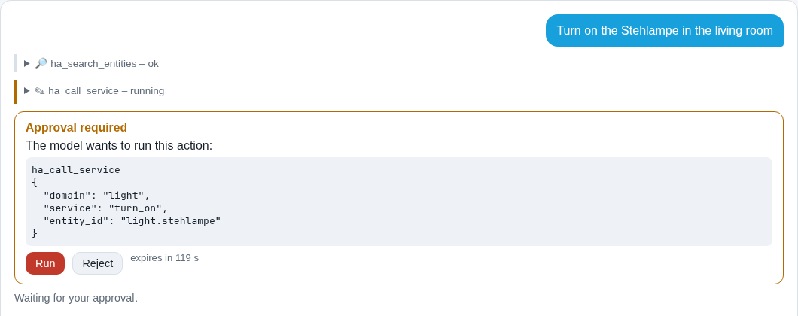

After *Run* the MCP switches, reads the lamp back and the model reports the confirmed result:

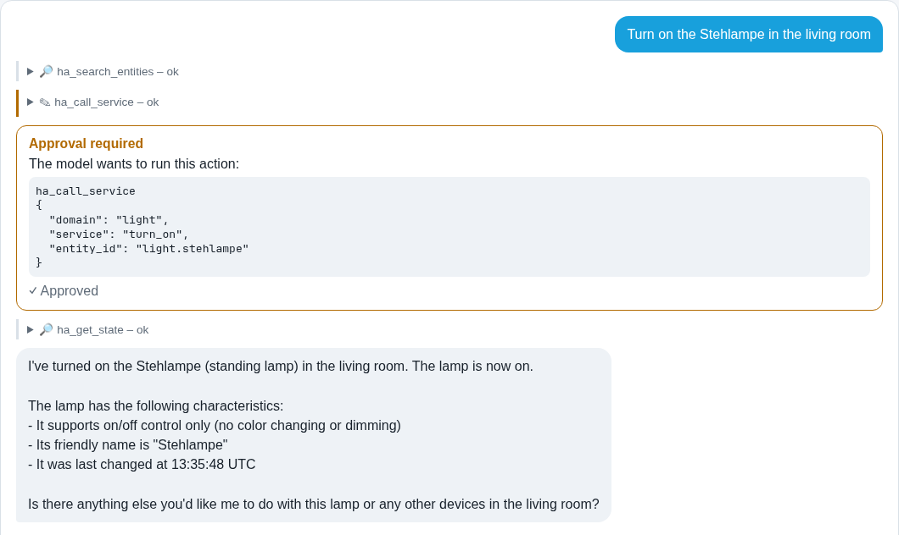

**Example of a refusal**: *"Put milk on the shopping list"* while `todo` is not an allowed domain. Even
after approval the MCP refuses and the model explains what is missing:

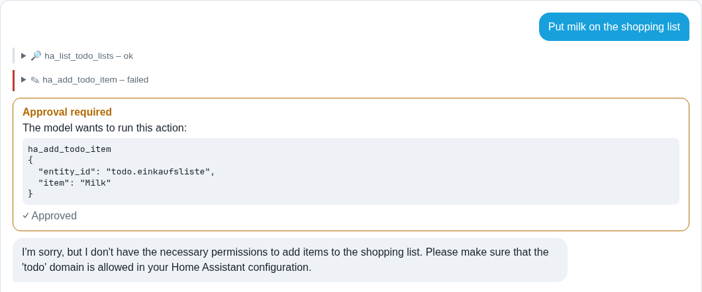

## 3. Automations

| Tool | What it does | Level |
|---|---|---|
| `ha_validate_automation` | Lets Home Assistant check triggers, conditions and actions without saving. | Read |
| `ha_get_automation` | Reads an automation's configuration. | Read |
| `ha_save_automation` | Validates, creates or updates an automation and reads it back. Journaled. | Configure |
| `ha_delete_automation` | Deletes an automation. Journaled: undo recreates it. | Delete |

**Example**: *"Create an automation that turns on the Stehlampe at sunset if it is off."*
The approval card shows the full configuration, e.g.:

```json
{"alias": "Abendlicht", "triggers": [{"trigger": "sun", "event": "sunset"}],
 "conditions": [{"condition": "state", "entity_id": "input_boolean.demo_stehlampe", "state": "off"}],
 "actions": [{"action": "light.turn_on", "target": {"entity_id": "light.stehlampe"}}], "mode": "single"}
```

Why an automation ran or not: see [section 11](#11-debugging-why-did-something-not-happen).

## 4. Scripts and scenes

| Tool | What it does | Level |
|---|---|---|
| `ha_list_scripts` | Scripts with ID, whether they are running and when they last ran. | Read |
| `ha_get_script` | A script's stored configuration. | Read |
| `ha_save_script` | Creates or replaces a script (HA validates the sequence first). Journaled. | Configure |
| `ha_delete_script` | Deletes a script. Journaled. | Delete |
| `ha_list_scenes` | Scenes with the entities they control. | Read |
| `ha_get_scene` | A scene's stored target states. | Read |
| `ha_save_scene` | Creates or replaces a scene, e.g. `{"name": "Abendlicht", "entities": {"light.stehlampe": {"state": "on", "brightness": 120}}}`. Journaled. | Configure |
| `ha_delete_scene` | Deletes a scene. Journaled. | Delete |

Running them is in [section 2](#2-switch-devices-run-scenes-and-scripts) (`ha_run_script`, `ha_activate_scene`).

**Example**: *"Lege ein Skript 'Gute Nacht' an, das alle Lampen im Wohnzimmer ausschaltet."*

## 5. Dashboards, custom cards and themes

| Tool | What it does | Level |
|---|---|---|
| `ha_list_dashboards` | Dashboards with URL path. | Read |
| `ha_get_dashboard` | A dashboard's views and cards. | Read |
| `ha_create_dashboard` | Creates a new dashboard and checks it appears. Journaled. | Configure |
| `ha_save_dashboard` | Saves views and cards and reads them back. Journaled. | Configure |
| `ha_update_dashboard` | Changes title, icon or sidebar display. Journaled. | Configure |
| `ha_delete_dashboard` | Deletes a dashboard. Journaled. | Delete |
| `ha_list_dashboard_resources` | Custom card files (JavaScript/CSS) the frontend loads. | Read |
| `ha_add_dashboard_resource` | Registers a card file served by your own Home Assistant (`/local/...`, `/hacsfiles/...`). External URLs are refused because resources run in every user's browser. Journaled. | Configure |
| `ha_delete_dashboard_resource` | Removes a resource. Journaled. | Delete |
| `ha_list_themes` | Installed themes and the current defaults. | Read |
| `ha_set_theme` | Sets the default theme for light or dark mode. Journaled. | Configure |

**Example**: *"Create a dashboard 'Living room' with one card for each lamp in the Wohnzimmer."*

## 6. Helpers

Helpers are the building blocks under *Settings → Devices & services → Helpers*.

| Tool | What it does | Level |
|---|---|---|
| `ha_list_helpers` | Helpers of one type: toggle, number, dropdown, text, date/time, button, counter, timer, schedule. | Read |
| `ha_list_helper_types` | Which helper types exist and how to create them, including template, group, utility meter, derivative, threshold and time-of-day helpers (set up through a guided flow, see [section 9](#9-integrations)). | Read |
| `ha_create_helper` | Creates a simple helper (e.g. a timer `{"name": "Tee", "duration": "00:04:00"}` or a schedule). Journaled. | Configure |
| `ha_update_helper` | Changes a helper and reads it back. Journaled. | Configure |
| `ha_delete_helper` | Deletes a helper. Journaled. | Delete |

**Example**: *"Create a template sensor that counts how many lamps are on."* The model starts the
template flow with `ha_start_integration_setup` and fills in the form step by step, each step with its own card.

## 7. Rooms, floors, devices and entities

| Tool | What it does | Level |
|---|---|---|
| `ha_create_area` | Creates a room. Journaled. | Configure |
| `ha_update_area` | Renames a room or changes floor, icon or aliases. Journaled. | Configure |
| `ha_delete_area` | Deletes a room; its devices stay and lose the room. Journaled. | Delete |
| `ha_create_floor` | Creates a floor with level. Journaled. | Configure |
| `ha_update_floor` | Changes a floor. Journaled. | Configure |
| `ha_delete_floor` | Deletes a floor; its rooms stay. Journaled. | Delete |
| `ha_update_device` | Moves a device to a room, renames or disables it, sets labels. Journaled. | Configure |
| `ha_get_device_removal` | Preview before removing a device: its entities, devices connected through it, where the entities are used, and whether its integration can remove devices at all. | Read |
| `ha_remove_device` | Removes a device and its entities, like *Delete* on HA's device page. Only if the integration supports it; **cannot be undone** by the MCP. In the chat it always shows an approval card with the preview. | Delete |
| `ha_list_orphaned_entities` | Entities no integration provides any more (HA: "not provided"), leftovers of removed devices. | Read |
| `ha_remove_entity` | Removes one such orphaned entity. Entities that are still provided are refused (HA would add them again; disable them instead). Cannot be undone. | Delete |
| `ha_update_entity_registry` | Changes an entity's name, icon, room, labels, categories, voice-assistant aliases, hidden/disabled. Journaled. | Configure |
| `ha_rename_entity` | Changes an entity ID (`light.x` → `light.y`); HA keeps the history. Lists the automations, scripts and dashboards that still use the old ID. Journaled. | Configure |

**Example**: *"Move the Arbeitslicht to the Küche and give it the alias 'Kitchen light'."*

**Example (removing)**: *"Remove the old Outlet 3."* → the model shows the preview (`ha_get_device_removal`):
one switch entity, not used anywhere, the integration supports removal. After your approval it is gone. If an
integration does not support removing (for example *Sun*), the MCP says so and suggests disabling instead.
The card always comes, even when deletes may run without approval (rejected here, nothing was removed):

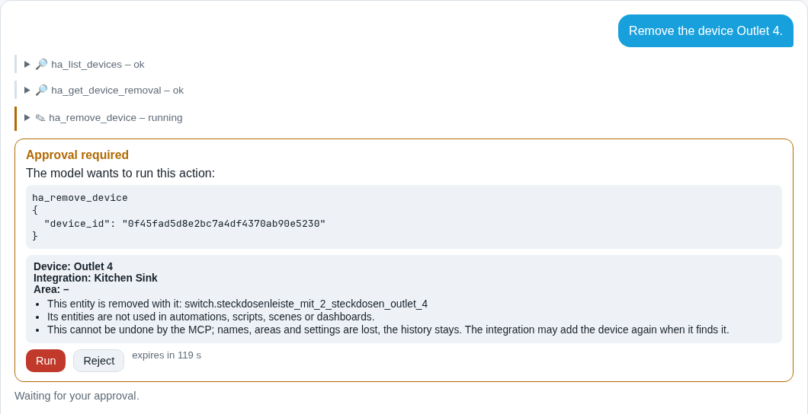

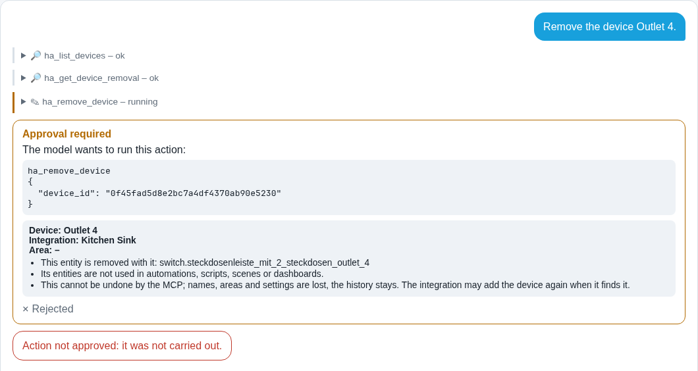

## 8. Labels, categories and zones

| Tool | What it does | Level |
|---|---|---|
| `ha_list_labels` | Labels with colour, icon and how many entities, devices and rooms carry them. | Read |
| `ha_get_label` | One label with everything that carries it. | Read |
| `ha_create_label` | Creates a label (HA theme colour or `#rrggbb`, `mdi:` icon). Journaled. | Configure |
| `ha_update_label` | Changes a label. Journaled. | Configure |
| `ha_delete_label` | Deletes a label everywhere; undo puts it back on the same items. | Delete |
| `ha_list_categories` | Categories of the automation, script, scene or helper list. | Read |
| `ha_create_category` | Creates a category. Journaled. | Configure |
| `ha_update_category` | Renames a category or changes its icon. Journaled. | Configure |
| `ha_delete_category` | Deletes a category; undo files the items again. | Delete |
| `ha_list_zones` | Zones with position, radius, persons inside and whether they can be edited (`zone.home` and YAML zones cannot). | Read |
| `ha_create_zone` | Creates a zone (e.g. work) with radius in metres; passive zones only serve automations. Journaled. | Configure |
| `ha_update_zone` | Moves, resizes or renames a zone. Journaled. | Configure |
| `ha_delete_zone` | Deletes a zone; undo recreates it. | Delete |

**Example**: *"Lege ein Label 'Doku-Demo' in Blau an."* The card shows name and colour:

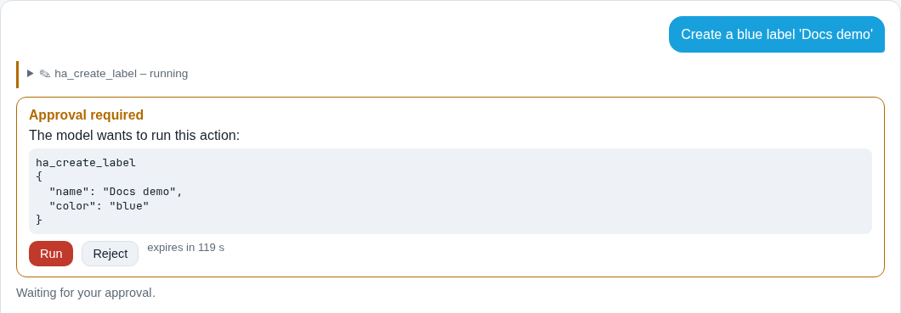

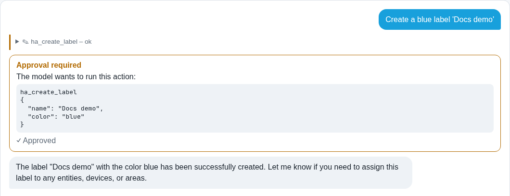

## 9. Integrations

Set up, configure and maintain integrations the way the HA UI does it, step by step.

| Tool | What it does | Level |
|---|---|---|
| `ha_list_integrations` | Configured integrations with state (loaded, failed, ...). | Read |
| `ha_list_integration_types` | Integrations that can be added through the UI, filtered by name (e.g. "shelly"). | Read |
| `ha_list_discovered` | Devices Home Assistant itself discovered and that wait for confirmation. This does not scan your network. | Read |
| `ha_list_credentials` | Names of your stored logins and their fields (never the values). | Read |
| `ha_start_integration_setup` | Starts adding an integration or a guided helper; returns the first form or menu. | Configure |
| `ha_integration_setup_step` | Submits one form step. Password, token, API key and PIN fields only accept a reference to *Zugangsdaten*, never a plain value. A created integration is journaled (undo removes it). | Configure |
| `ha_abort_integration_setup` | Aborts a running setup. | Configure |
| `ha_start_integration_options` | Opens the options of an integration with its current values. | Configure |
| `ha_integration_options_step` | Submits one options step. | Configure |
| `ha_abort_integration_options` | Closes the options without saving. | Configure |
| `ha_start_integration_reconfigure` | Changes the connection (e.g. a new IP address). | Configure |
| `ha_update_integration` | Renames an integration or changes polling / new-entity options. Journaled. | Configure |
| `ha_set_integration_disabled` | Disables or re-enables an integration. Journaled. | Configure |
| `ha_reload_integration` | Reloads one integration. | Configure |
| `ha_delete_integration` | Removes an integration and its devices. | Delete |

**Example**: first store the Shelly login under *Credentials* as alias `shelly_login`, then ask *"Add the
Shelly with the IP 192.168.1.50, login shelly_login."* The model fills the password field with
`{"$credential": "shelly_login", "field": "password"}`; the MCP inserts the real value, the model never sees it.

## 10. Configuration files (YAML)

For everything the UI cannot express: `configuration.yaml`, packages, template sensors, custom components.
On HA OS / Supervised the official **File editor** add-on must be installed and started (nothing else to set
up); for a container install the operator sets `HA_CONFIG_DIR`.

| Tool | What it does | Level |
|---|---|---|
| `ha_list_config_files` | Shows a folder of the configuration directory with sizes and which files can be read. | Read |
| `ha_read_config_file` | Reads a text file. Passwords inside appear as `__REDACTED_1__`. | Read |
| `ha_edit_config_file` | Replaces one exact piece of text. | Configure |
| `ha_write_config_file` | Creates a file or replaces its whole content (e.g. a new package). | Configure |
| `ha_delete_config_file` | Deletes a file. | Delete |

How it is protected:

- **Never accessible**, not even for reading: `secrets.yaml`, `.storage`, databases, logs, key and credential
  files.
- **Passwords in files** are replaced by placeholders before the model sees them and written back unchanged.
  New passwords belong in `secrets.yaml` (by you) and are referenced with `!secret name`.
- **Before writing** the YAML syntax is checked; broken YAML is never saved.
- **After writing** Home Assistant checks the configuration. A new error or warning (e.g. "Setup of package
  failed") restores the previous file automatically, and the tool says why.
- Every write is journaled and can be undone. A change takes effect after `ha_reload` or `ha_restart`.

**Example**: *"Which files does configuration.yaml include?"*

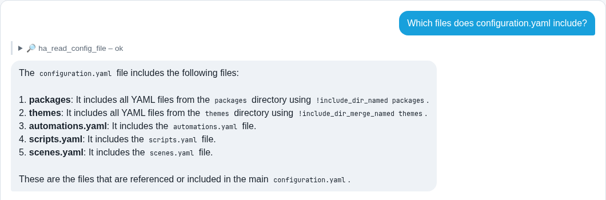

A typical edit the model sends (shown on the approval card):

```json
{"path": "configuration.yaml", "old_text": "default_config:\n",
 "new_text": "default_config:\n\nhomeassistant:\n  packages: !include_dir_named packages\n"}
```

## 11. Debugging: why did something (not) happen?

| Tool | What it does | Level |
|---|---|---|
| `ha_list_traces` | Recent runs of automations or scripts with the result in plain words (`outcome`: completed, stopped by a condition, error, ...) and what triggered them. | Read |
| `ha_get_trace` | The steps of one run with errors, results and changed variables. | Read |
| `ha_get_error_log` | Home Assistant's error and warning log, newest first, with repeat counts; filter by level or text. | Read |
| `ha_get_logbook` | What happened and what caused it (state changes, triggers, actions). | Read |
| `ha_get_history` | State history of up to 10 entities, in your time zone. | Read |
| `ha_get_statistics` | Long-term statistics (energy, temperatures) per hour, day, week or month. | Read |
| `ha_list_statistic_ids` | Which entities have long-term statistics. | Read |
| `ha_list_repairs` | Open repair issues (*Settings → Repairs*). | Read |
| `ha_get_system_health` | System health per component (database, installation type, ...). | Read |
| `ha_render_template` | Evaluates a Jinja template against the live state, e.g. `{{ states.light \| selectattr('state','eq','on') \| list \| count }}`. | Read |
| `ha_test_condition` | Tests a condition right now without saving anything. | Read |

**Example**: *"When and why did the automation Abendlicht last run?"*

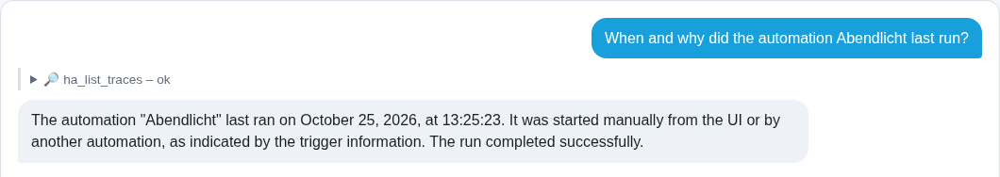

**Example**: *"When was the Stehlampe in the living room on today? Check the history."*

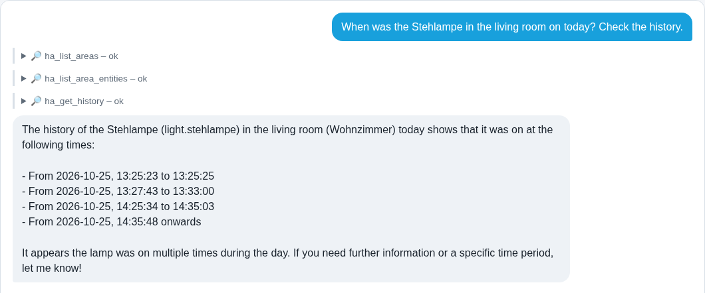

## 12. Overview and "where is this used?"

| Tool | What it does | Level |
|---|---|---|
| `ha_get_overview` | A compact picture of your installation: version, entities per domain (unavailable, on), rooms, devices, automations, dashboards, failing integrations. | Read |
| `ha_find_usages` | Where an entity or action is used: automations, scripts, scenes, groups and dashboards, with the place inside the configuration. Use it before renaming or removing something. | Read |

**Example**: *"Which automations, scripts or dashboards use the Stehlampe?"*

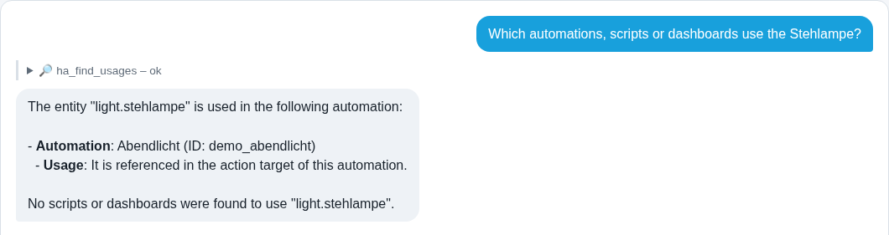

**Example**: *"Give me a short overview of my Home Assistant."*

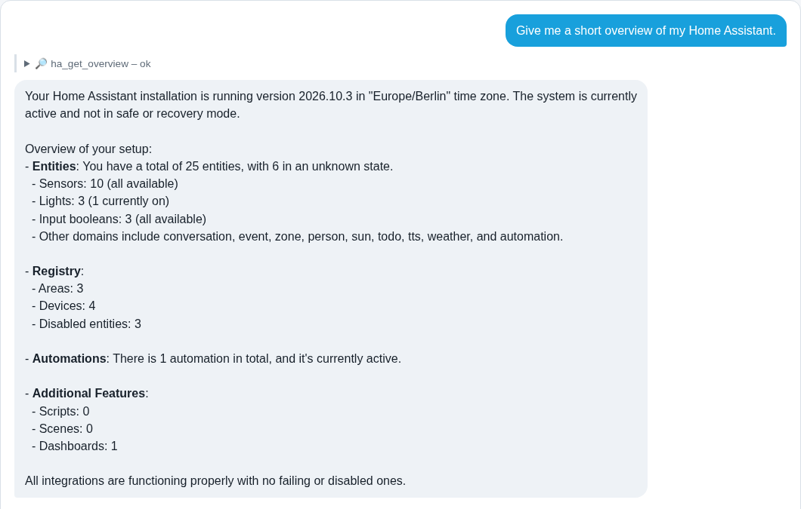

## 13. Calendars and to-do lists

| Tool | What it does | Level |
|---|---|---|
| `ha_list_calendars` | Calendar entities. | Read |
| `ha_get_calendar_events` | Events of one or all calendars for 1-31 days. | Read |
| `ha_create_calendar_event` | Adds an event (with time or all-day). Needs `calendar` allowed. | Control |
| `ha_update_calendar_event` | Changes an event or one occurrence of a series. | Control |
| `ha_delete_calendar_event` | Deletes an event. Cannot be undone. | Delete |
| `ha_list_todo_lists` | To-do lists (e.g. the shopping list) with open items. | Read |
| `ha_get_todo_items` | Items of a list (open, done or all). | Read |
| `ha_add_todo_item` | Adds an item. Needs `todo` allowed; unknown lists are reported. | Control |
| `ha_update_todo_item` | Ticks off, reopens, renames an item or sets a due date. | Control |
| `ha_remove_todo_items` | Removes items. Cannot be undone; ticking off is usually what you want. | Delete |

Calendar entries and list items are your data, not configuration, so they are not in the change journal.

**Example**: *"What is in the calendar tomorrow?"*, *"Tick off milk on the shopping list."*

## 14. Weather

| Tool | What it does | Level |
|---|---|---|
| `ha_get_weather_forecast` | Current weather and forecast (daily, hourly, twice daily) in your time zone; each entry is labelled "today", "tomorrow" or with the weekday, and `day` picks one day. | Read |

**Example**: *"Wie wird das Wetter morgen?"*

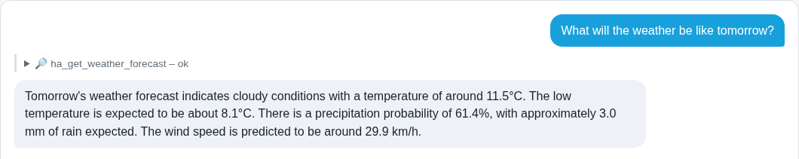

## 15. Updates, configuration check, reload and restart

| Tool | What it does | Level |
|---|---|---|
| `ha_list_updates` | Pending updates (Home Assistant, add-ons, firmware, integrations) with versions. | Read |
| `ha_get_release_notes` | Release notes of one update. | Read |
| `ha_check_config` | Checks the configuration files (valid or errors and warnings); changes nothing. | Read |
| `ha_reload` | Reloads configuration without restart: everything, the core configuration or one part such as automations or templates. | Configure |
| `ha_skip_update` | Skips an offered version (or offers it again). | Configure |
| `ha_install_update` | Installs an update, optionally with a backup first. Far-reaching, therefore the delete level. | Delete |
| `ha_restart` | Restarts Home Assistant, only after a successful configuration check. Interrupts automations for about a minute. | Delete |

**Example**: *"Are there any updates?"*, *"Check the configuration and then reload the automations."*

## 16. Backups

| Tool | What it does | Level |
|---|---|---|
| `ha_list_backups` | Backups, newest first, with size and where they are stored. | Read |
| `ha_get_backup` | One backup in detail (date, HA version, contents, size, encrypted) and what restoring it would change. | Read |
| `ha_create_backup` | Creates a full backup and waits until it is listed; an encryption password only as a reference to *Credentials*. | Configure |
| `ha_delete_backup` | Deletes one backup. | Delete |
| `ha_restore_backup` | Restores Home Assistant's configuration and, if you want, the history database from a backup; HA restarts. | Delete |

**Restoring** is the most far-reaching action of the MCP, so it has the strongest protection:

- It needs the **Delete** level, and in the web UI chat it **always** shows an approval card, even when the
  Delete level is set to "run without approval".
- The card names the backup (name, date, HA version, contents, size) and says in plain words what happens:
  configuration back to that date, changes since then lost, newer users and tokens stop working, HA restarts.
- Right before restoring, the MCP makes a **safety backup** of the current state. If that fails, nothing is
  restored. Restoring the safety backup undoes the restore.
- Only configuration and (optionally) the database are restored, never add-ons or folders. On Home Assistant OS a
  backup with a database can only be restored together with it; the MCP says so before doing anything. Encrypted backups need
  their password as a reference to *Credentials*.
- The tool waits until Home Assistant is back and reports `restored: true/false` from HA's own restore result.

**Example**: *"Restore the backup from this morning, but keep the history."* The model looks the backup up with
`ha_get_backup`, asks for approval with `restore_database: false`, and afterwards names the safety backup you can
go back to. The card in the chat (rejected here, so nothing happened):

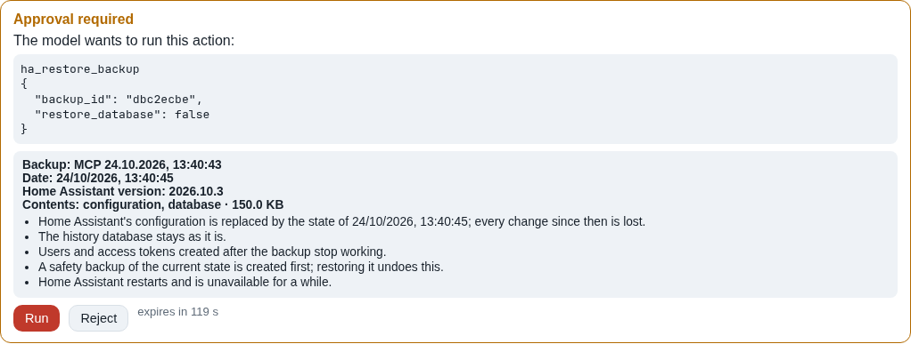

The *Backups* page in the web UI lists the backups and can create, download, restore and delete them; restoring
asks first with the same explanation:

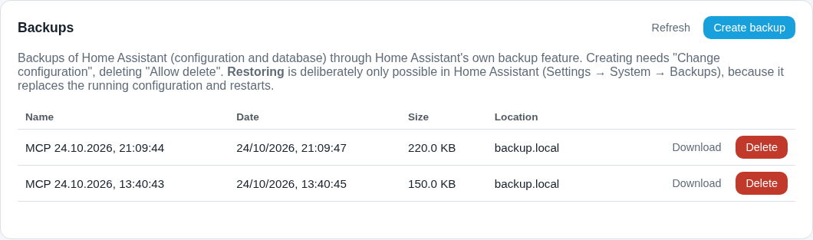

## 17. Blueprints

| Tool | What it does | Level |
|---|---|---|
| `ha_list_blueprints` | Blueprints for automations, scripts or templates with their inputs and source. | Read |
| `ha_preview_blueprint` | Lets Home Assistant fetch a blueprint from an https URL and shows name, inputs and problems without saving. | Configure |
| `ha_save_blueprint` | Imports a blueprint; existing ones are never overwritten. Journaled: undo deletes it. | Configure |
| `ha_delete_blueprint` | Deletes a blueprint (HA refuses while it is in use); undo imports it again from its source. | Delete |

**Example**: *"Import the motion-light blueprint from <URL> and use it to create an automation for the
hallway."* The automation then uses `{"use_blueprint": {"path": "...", "input": {...}}}`.

## 18. Add-ons, system, HACS, Zigbee and Thread

Everything here is read-only except the HACS store: there you can search, install, update and remove (see the
second table). Without a Supervisor, HACS or ZHA the tools say so instead of failing. No device addresses, IP
addresses, host names or network keys are returned.

| Tool | What it does | Level |
|---|---|---|
| `ha_list_addons` | Installed add-ons with state, version and pending update. | Read |
| `ha_get_system_info` | Versions of Core, Supervisor and OS, Supervisor health, board and disk usage. | Read |
| `ha_list_hacs_repositories` | What is installed through HACS, with installed and available version. | Read |
| `ha_list_zigbee_devices` | Zigbee devices with availability, signal quality and last contact; `problems_only` shows only unavailable or weak ones. | Read |
| `ha_list_thread_networks` | Thread networks (name, channel, preferred). | Read |

**Example**: *"Which Zigbee devices have poor reception or are offline?"*

**HACS store: install cards, custom integrations and themes.** HACS is the community store for Home Assistant
(it must already be installed in Home Assistant). Whatever comes from there is code from strangers that runs with
Home Assistant's rights, so installing always shows an approval card with stars, last update and what happens next.

| Tool | What it does | Level |
|---|---|---|
| `ha_search_hacs` | Searches the store by words in name, description and topics, optionally only one kind (`plugin` = dashboard card, `integration`, `theme`, ...); sorted by GitHub stars. | Read |
| `ha_get_hacs_repository` | One repository with stars, last update, releases, installed version and what installing it means. | Read |
| `ha_install_hacs_repository` | Installs or updates (newest version or a chosen release). A card is registered as dashboard resource right away; an integration needs a restart. Always with an approval card in the chat. Journaled: undo removes a new install or goes back to the previous version. | Configure |
| `ha_add_hacs_custom_repository` | Adds a GitHub repository that is not in the store (only `github.com`). It is only listed, not installed. | Configure |
| `ha_remove_hacs_repository` | Removes an installed repository. A card still used in a dashboard then shows an error. Undo reinstalls the same version. | Delete |

**Example**: *"Install the card-mod card from HACS."* → the model searches, shows the card (5,000 stars, last
update, "registers a dashboard resource"), you approve, and the card can be used after a browser reload.

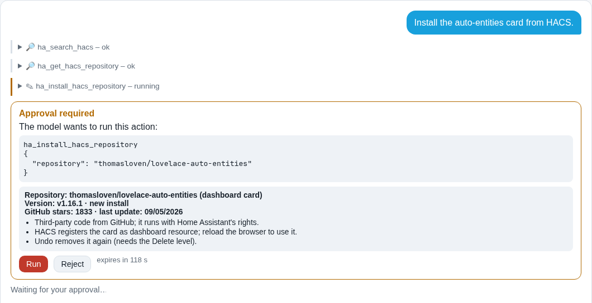

## 19. Energy: plugs, solar, battery storage

Home Assistant's energy dashboard shows where electricity comes from (grid, solar, battery storage) and which
devices use it, for example smart plugs. The MCP reads and changes the same settings that you find in HA under
**Settings → Dashboards → Energy**, and it can sum up the usage per device.

| Tool | What it does | Level |
|---|---|---|
| `ha_get_energy_config` | The energy settings: sources (grid, solar, battery, gas, water) and single devices, each with HA's own check (for example "sensor does not exist") and a plain explanation. | Read |
| `ha_find_energy_sensors` | Sensors that could go into the energy dashboard (energy, power, battery, gas, water), with unit, whether they have statistics and whether they are already used. | Read |
| `ha_get_energy_usage` | kWh per source and per device for today, yesterday, 7 days, 30 days or this month. | Read |
| `ha_get_solar_forecast` | The solar forecast of a forecast integration (e.g. Forecast.Solar), Wh per hour. | Read |
| `ha_save_energy_config` | Replaces whole parts of the settings, for example all sources when you add solar and a battery. New sensors must have statistics. Journaled. | Configure |
| `ha_add_energy_device` | Adds one device, typically a smart plug's energy sensor, optionally with its power sensor for live values. Journaled. | Configure |
| `ha_remove_energy_device` | Removes one device from the energy dashboard; its history stays. Journaled. | Delete |

**Protection**: changes are checked before they are saved (only known source types and fields, new sensors
must exist in the statistics), so a typo cannot break the energy dashboard. Old entries that point to a vanished
sensor do not block other changes. Every change is in the change journal, *Undo* puts the previous settings back.

**Examples**:

- *"How much did my plugs use today?"* → `ha_get_energy_usage` lists the devices sorted by kWh.
- *"Add the terrace plug to the energy dashboard."* → `ha_find_energy_sensors` finds
  `sensor.terrace_plug_energy`, `ha_add_energy_device` adds it (approval card).
- *"I have a balcony solar system with a battery: set up solar and storage."* → the model reads the current
  settings, picks the inverter's energy sensor as solar source and the battery's charge/discharge counters as
  battery source, and saves all sources at once.
- *"Which energy entries are broken?"* → `ha_get_energy_config` shows the entries whose sensor no longer exists.

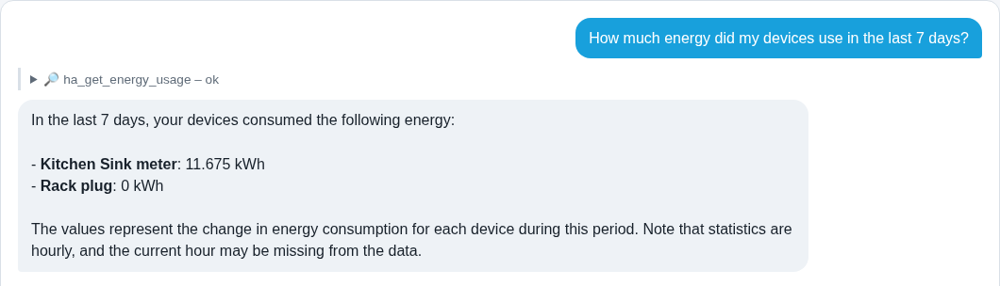

## 20. Voice assistants (Assist)

Assist is Home Assistant's own voice assistant. The MCP manages its **pipelines** (which language, which
conversation agent, speech-to-text, text-to-speech, wake word), decides which entities voice assistants may
**use**, and can **test sentences** without running them.

| Tool | What it does | Level |
|---|---|---|
| `ha_list_assist_pipelines` | All pipelines with the preferred one marked, and the available conversation agents. | Read |
| `ha_save_assist_pipeline` | Creates a pipeline (name and language are enough) or changes single fields of one. Journaled. | Configure |
| `ha_set_preferred_assist_pipeline` | Makes a pipeline the preferred one. Journaled. | Configure |
| `ha_delete_assist_pipeline` | Deletes a pipeline, not the preferred one. Journaled; undo recreates it. | Delete |
| `ha_list_exposed_entities` | Which entities Assist, Alexa and Google Assistant may use, and whether new entities are added automatically. | Read |
| `ha_set_exposure` | Exposes entities to voice assistants or hides them. Journaled with the previous value of each entity. | Configure |
| `ha_set_expose_new_entities` | Whether entities added later are exposed automatically. Journaled. | Configure |
| `ha_test_assist_sentences` | Shows how Assist would understand sentences (intent, target entities) **without running anything**. | Read |

**Protection**: the sentence test only recognises; nothing is switched. A free "tell Assist to do something" tool
is deliberately missing: Assist would switch devices past the MCP's domain allowlist and protected rooms. For
switching use the normal tools.

**Examples**:

- *"Why does Assist not understand 'turn on the floor lamp'?"* → `ha_test_assist_sentences` shows that no entity
  is called that; the model suggests an alias (`ha_update_entity_registry`) or exposing the lamp.
- *"Hide all switches in the cellar from Alexa."* → `ha_list_area_entities` finds them, `ha_set_exposure` with
  `assistants: ["cloud.alexa"]` hides them (approval card, undo possible).
- *"Create an English pipeline and make it the default."*

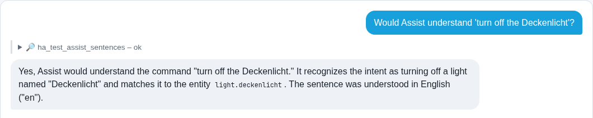

## 21. Change journal and undo

Before every configuration change made through the MCP the previous state is stored on this computer for 30
days. The *Changes* page lists them with an *Undo* button; the model can do the same.

| Tool | What it does | Level |
|---|---|---|
| `ha_list_changes` | Recent changes with what, target and whether they were undone. | Read |
| `ha_get_change` | One change with the stored previous state (passwords in files stay masked). | Read |
| `ha_undo_change` | Writes the previous state back (removes what was created, recreates what was deleted). The undo is journaled too and can itself be undone; with newer changes to the same item it refuses unless you insist. | Configure (Delete when it removes something) |

Not journaled: switching devices and firing events, calendar and to-do items, removing an integration, devices or
orphaned entities, options dialogs, updates, restarts and backups. A newly set-up integration is journaled (undo removes it).


## 22. Direct REST access (advanced)

For the rare case that no dedicated tool exists. Only documented routes of Home Assistant's REST API are
allowed, each with its permission class.

| Tool | What it does | Level |
|---|---|---|
| `ha_rest_catalog` | Lists the allowed routes and which level each needs. | Read |
| `ha_rest_query` | Calls a documented read route (or the safe template and config-check routes). | Read |
| `ha_rest_write` | Calls a documented write route. | Configure |
| `ha_rest_delete` | Calls a documented delete route. | Delete |

Prefer the dedicated tools above: they validate input, read results back and keep the change journal.
